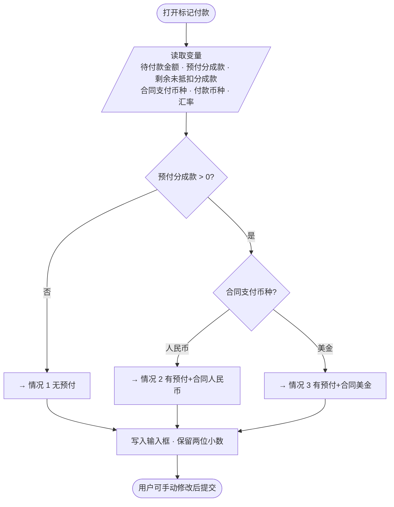

# 代理游戏台账 — UI 规范

> 原型路径：`src/prototypes/agent-game-finance/`  
> 预览：`/prototypes/agent-game-finance`  
> 最后更新：2026-11-03（退款结算按渠道归属选择结算公式）
> 原型版本：V1.0
> 历史追溯：[`requirement-history.md`](./requirement-history.md)；本文件只维护当前有效的 UI 与交互规范

本文档汇总「代理游戏台账」原型的 UI/交互规范，供后续对话、改页、加功能时统一引用。

---

## UI 基线与基础组件规范（最高优先级）

本节从当前可运行的「代理游戏台账」组件和交互中提炼，作为新增页面、重构页面及技术开发的统一 UI 基线。后续章节若存在旧名称、旧尺寸或旧交互，以本节和当前原型实现为准。

### 设计目标与适用范围

- 产品形态：桌面端财务管理后台，优先保证信息密度、金额可核对、操作路径明确。
- 默认视口：以桌面宽屏为主；内容不足时保持完整表头，内容超宽时由页面内容区承载滚动，不压缩关键金额和操作文案。
- 组件复用：优先使用 `components/` 下现有组件和 `agf-*` 样式，不在单个页面复制一套相似控件。
- 交互一致：同类查询、保存、结算、上传、状态反馈必须使用一致入口、状态和文案结构。
- 数据表达：ID 与名称、金额与币种、状态与时间均采用全平台统一格式；无值统一显示 `-`，空列表统一显示“暂无数据”。

### 页面骨架与空间体系

| 区域 | 规范 | 实现 |
|------|------|------|
| 整体布局 | 左侧固定导航 + 右侧顶部栏 + 内容区 | `AdminLayout`、`Sidebar` |
| 侧栏 | 宽 `220px`，深色背景 `#2C324E`；Logo 高 `48px` | `--sidebar-width`、`.agf-sidebar` |
| 顶部栏 | 高 `48px`，左右 padding `24px`，白底，下边框 | `.agf-header` |
| 内容区 | padding：上 `16px`、左右及下 `24px` | `.agf-content` |
| 页面卡片 | 白底、圆角 `4px`；列表统一横向 gutter `24px` | `.agf-card`、`--agf-gutter` |
| 基础间距 | 以 `4px` 为最小单位；常用 `8/12/16/20/24/32px` | 查询栏 gap `12px`、表单项间距 `20px` |
| 圆角 | 输入、按钮、表格、标签通常 `4px`；Modal `8px` | `style.css` |

页面层级顺序固定为：面包屑 → 页面卡片 → 查询栏/操作栏 → 主列表 → 分页。页面没有独立标题时，以面包屑当前项表达页面名称。

### 字体与图标

| 用途 | 字号/字重 | 颜色 |
|------|-----------|------|
| 页面正文 | `14px / 400` | `#333333` |
| 查询输入、表格正文 | `13px / 400` | `#333333` |
| 表头 | `13px / 700` | `#333333` |
| 抽屉/弹窗标题 | `16px / 500` | `#333333` |
| 表单小标题 | `14px / 700` | `#333333` |
| 辅助说明 | `12px / 400` | `#999999` |
| 校验错误 | `12px / 400` | `#F56C6C` |

- 字体栈：系统字体、`Segoe UI`、`PingFang SC`、`Microsoft YaHei`。
- 图标优先使用 `lucide-react`，常用尺寸 `14/16/18px`；图标必须服务于识别，不单独替代有歧义的业务文案。
- 关闭、翻页、筛选等纯图标按钮必须有 `aria-label` 或 `title`。

### 颜色与层级 Token

| Token | 值 | 用途 |
|-------|----|------|
| `--color-primary` | `#4165D7` | 主按钮、选中态、链接、聚焦边框 |
| `--color-primary-hover` | `#5474DB` | 主按钮悬停 |
| `--color-text` | `#333333` | 正文、表头 |
| `--color-text-secondary` | `#666666` | 次要内容 |
| `--color-text-muted` | `#999999` | 占位、提示、无值说明 |
| `--color-border` | `#E8E8E8` | 输入、卡片、表格边框 |
| `--color-table-head` | `#FAFAFA` | 表头背景 |
| `--color-page-bg` | `#F0F2F5` | 页面背景 |
| 成功 | `#67C23A / #F0F9EB` | 成功 Toast、成功状态 |
| 警告 | `#FA8C16 / #FFF7E6` | 待处理状态 |
| 错误 | `#F56C6C / #FEF0F0` | 校验和失败反馈 |

浮层层级不得由页面任意设置：页面遮罩 `1000`、抽屉 `1001`、Toast `2000`、表头筛选 Portal `10000`、搜索选择器 `10002`、日期面板 `20001`。日期组件位于弹窗内时必须完整置顶，不得被弹窗滚动区域裁切。

### 基础组件清单

| 组件 | 文件 | 统一用途 |
|------|------|----------|
| `AdminLayout` | `components/AdminLayout.tsx` | 侧栏、顶部栏、面包屑、内容区 |
| `Sidebar` | `components/Sidebar.tsx` | 分组菜单展开/收起与当前页高亮 |
| `FilterBar` | `components/FilterBar.tsx` | 业务类型、查询字段、列表操作的统一容器 |
| `ListSearchFields` | `components/ListSearchFields.tsx` | 游戏、厂商关键词查询 |
| `DataTable` | `components/DataTable.tsx` | 主列表、空状态、固定汇总行、分页 |
| `Pagination` | `components/Pagination.tsx` | 总数、每页条数、页码切换 |
| `ColumnFilter` | `components/ColumnFilter.tsx` | 枚举或文本表头筛选 |
| `ColumnSort` | `components/ColumnSort.tsx` | 表头升降序切换 |
| `Modal` / `Drawer` / `Toast` | `components/Modal.tsx` | 确认、复杂录入、侧边详情、结果反馈 |
| 表单基础组件 | `components/FormFields.tsx` | 只读值、金额、百分比、提示、错误、小标题 |
| `DatePicker` | `components/DatePicker.tsx` | 精确到天的单日期选择 |
| `MonthRangePicker` | `components/MonthRangePicker.tsx` | 月份范围选择 |
| `MockFileUpload` | `components/MockFileUpload.tsx` | 文件选择、文件列表、下载和删除 |
| `StatusBadge` | `components/StatusBadge.tsx` | 业务状态标签 |

新增通用交互前先判断是否可以扩展现有组件；只有跨页面无法复用时才新增基础组件，并同步本节。

### 按钮规范

| 类型 | class | 使用场景 | 视觉 |
|------|-------|----------|------|
| 主按钮 | `agf-btn--primary` | 添加、保存、确认、导入、拉取、结算 | 主色底、白字 |
| 次按钮 | `agf-btn--default` | 取消、关闭、返回 | 白底、灰边 |
| 文字操作 | `agf-btn--link` | 表格操作列 | 无底色、主色文字 |
| 危险文字操作 | `agf-btn--danger-link` | 删除等不可逆操作 | 红色文字 |

- 所有常规按钮高度 `32px`、圆角 `4px`、字号 `13px`、水平 padding `16px`、图文间距 `6px`。
- 一个操作区只设一个明确主操作；弹窗/抽屉底部顺序固定为“取消”在左、主操作在右。【合同管理】【已付款项】【结算公式】【数据拉取】【付款设置】【请款凭证】抽屉的主按钮统一显示“确定”。
- 表格操作列使用文字按钮，按业务流程从左到右排列；不使用图标替代“编辑、结算、记录”等关键动作。
- 禁用态使用灰底、灰边、灰字和 `not-allowed`；禁用原因应可由当前页面状态或相邻说明理解。
- 异步按钮点击后立即进入处理中状态并防止重复提交；成功或失败后用 Toast 反馈。

### 查询栏与筛选规范

- `FilterBar` 第一行固定以业务类型开始，后接查询字段；字段间距 `12px`，控件高度统一 `32px`。
- 查询输入默认宽 `200px`；业务类型选择宽 `100px`；月份范围最小宽 `228px`。
- 同一输入框内允许 ID/名称“或”匹配，不同查询框和表头筛选之间使用“且”关系。
- 查询条件变更后即时刷新列表，不额外设置“查询”按钮；数据变化时 `DataTable` 自动回到第 1 页。
- 页面级主操作可通过 `actions` 放到第二行；导出等与查询紧密相关的操作可跟在查询字段后。
- 枚举筛选优先用 `ColumnFilter`；筛选菜单 Portal 到 `body`，不得被表格裁切；有筛选值时漏斗显示主色。
- 表头筛选选项第一项固定为“全部”，点击选项后立即生效并关闭菜单。

### 输入与表单规范

#### 通用输入

- 输入框、下拉框高度 `32px`，边框 `1px solid #E8E8E8`，圆角 `4px`；聚焦边框为主色。
- 页面查询控件字号 `13px`；抽屉表单字号 `14px`。
- 占位文案使用 `#999999`；只读值用纯文本，不伪装成禁用输入框。
- 文本域最小高度 `80px`，仅在确有多行内容时使用。
- 必填项在字段名前显示红色 `*`；必填与选填由业务规则决定，不在 placeholder 中重复说明。

#### 抽屉横向表单

- 标签固定宽 `168px`、右对齐，内容区自适应；标签后由样式统一生成中文冒号“：”。
- 表单项默认底间距 `20px`；标签和输入框左右布局，不使用同一抽屉内的上下布局。
- 区块标题使用 `FormSectionTitle`，区块间上边距 `24px`、下边距 `16px`。
- `FieldHint` 位于输入组件下方，错误发生时 `FieldError` 再显示在灰色说明下方。
- 校验错误既要定位到具体字段，也要显示页面级错误 Toast；字段输入发生变化时清除该字段旧错误。
- 金额输入失焦后统一格式化至两位小数；百分比按组件规则限制整数或最多两位小数。

#### 复合输入

| 组件 | 规则 |
|------|------|
| `CurrencyInput` | 左侧显示 `￥/$`；仅允许非负数字及最多两位小数 |
| `PercentAffixInput` | 右侧固定 `%` 后缀 |
| `DecimalPercentInput` | 数据存小数，界面显示百分数，范围 `0–100`，最多两位小数 |
| `PercentInput` | 数据存小数，界面输入 `0–100` 整数 |
| `ReadonlyCurrencyField` | 未维护时显示 `-`，已维护时显示币种符号和两位小数 |

复合输入的前后缀背景统一 `#F5F7FA`，前后缀与输入区共享同一聚焦边框。

### 表格与金额规范

- 主列表统一使用 `DataTable`；表格外框白底、灰色实线边框、圆角 `4px`。
- 表头不换行，背景 `#FAFAFA`，字号 `13px`、字重 `700`；单元格 padding `12px 16px`。
- 普通列左对齐；金额列使用 `COL_ALIGN_RIGHT`，表头和内容同时右对齐，并启用等宽数字。
- 游戏和厂商统一用 `DualCell` 显示为 `ID / 名称`；斜杠前后保留空格。
- 金额统一显示币种符号、千分位和两位小数；人民币用 `￥`，美金用 `$`。
- 多币种金额使用 `CurrencyStackCell` 上下排列，不在一个数字中混合币种。
- 主列表默认按数据添加时间倒序；新增、拉取、导入、申请生成的记录必须显示在最前面。
- 未结算、未填写或不适用的数据统一显示 `-`，不显示空字符串或虚假的 `0.00`。
- 空数据仍保留表头，表体显示空盒插画和“暂无数据”，分页显示“共 0 条”。
- 查询总计使用 `leadingRow` 或 `trailingRow`，固定行不参与分页；总计口径必须跟随当前筛选结果。

### 分页规范

- 默认 `20条/页`；允许 `10/20/30/50/100/200`。
- 分页位于表格外框下方并水平居中，依次展示总数、每页条数、上一页、页码、下一页。
- 数据条数或筛选结果变化后回到第 1 页；当前页超过最大页数时自动回退。
- 第一页禁用上一页，最后一页禁用下一页；页码过多时使用省略号。

### Modal、Drawer 与浮层

#### Modal

| 规格 | 宽度 | 使用场景 |
|------|------|----------|
| 默认 | 最大 `560px` | 普通确认、说明 |
| `compact` | `420–480px` | 简短确认、申请付款 |
| `large` | 最大 `720px` | 中等复杂内容 |
| `xl` | 最大 `960px` | 导入预览等宽表格 |

- 最大高度 `90vh`；只有日期下拉等必须溢出显示的场景使用 `overflowVisible`，避免弹窗内部产生不必要的上下滚动。
- 默认 header/footer 有分隔线；`plain` 用于轻量确认和导入等无分隔线布局。
- 点击遮罩、右上角关闭或按 `Esc` 均关闭；内容区点击不得冒泡关闭。

#### Drawer

- 默认从右侧进入，宽 `730px`、最大 `90vw`；特殊展示可通过 `width` 明确指定，不新增页面私有宽度 class。
- header 与 footer 固定，body 独立滚动；底部按钮右对齐。
- 编辑、详情、记录、配置等需要保留主列表上下文的操作优先使用 Drawer。
- 简短二次确认、文件导入和阻断提示优先使用 Modal。

#### 浮层关闭规则

- 日期、月份、筛选、搜索选择器点击组件外关闭。
- 选择明确选项或日期后立即关闭并生效。
- 保存失败时保持当前 Modal/Drawer 打开并保留用户输入；保存成功后按业务规则关闭并 Toast 反馈。

### 日期与月份组件

- `DatePicker` 输出 `YYYY-MM-DD`；默认日期由业务层传入，申请付款场景默认当天。
- 日历支持上一年、上一月、下一月、下一年；选中日期主色圆形高亮，非本月日期弱化。
- 弹窗中的日历向上展开且层级置顶，不能造成弹窗上下滚动或被底部裁切。
- `MonthRangePicker` 输出 `YYYY-MM - YYYY-MM`；第一次选择开始月，第二次选择结束月后关闭。
- 未来月份禁用；选中区间浅蓝连接，起止月份主色高亮。

### 上传组件

- 报表数据导入使用大面积虚线上传区；凭证附件使用 `MockFileUpload` 的“选择文件”按钮和文件列表。
- 上传区 hover 使用主色边框和文字；禁用时降低透明度并显示不可点击光标。
- 已上传文件显示文件图标、可点击文件名、成功图标和删除入口。
- 文件格式、大小、表头和数据内容校验按业务文档执行；校验失败不展示成功预览数据。
- 上传失败在上传区下方显示红色错误；成功后再进入预览或文件列表状态。

### 状态、反馈与校验

| 状态 | 表现 |
|------|------|
| 成功 | 绿色 Toast，显示 `3秒` |
| 失败 | 红色 Toast + 对应字段下红字，显示 `3秒` |
| 禁用 | 灰色按钮，不响应点击 |
| 处理中 | 按钮文案切换为“处理中...”类状态并禁止重复提交 |
| 空数据 | 表头保留 + “暂无数据”空状态 |
| 无权限 | 功能入口隐藏；URL 直接访问显示“暂无权限” |

- Toast 用于结果反馈，不替代字段错误；字段错误用于告诉用户具体修改位置。
- 多字段校验时一次扫描并展示全部字段错误，页面 Toast 统一提示“请完善所有信息”。
- 批量结算、批量导入等原子操作任一数据失败时不得部分落库。
- 删除、覆盖或其他不可逆动作必须有确认；普通取消和关闭不保存当前未提交内容。

### 状态标签

| 类型 | 适用状态 | 样式 |
|------|----------|------|
| success | 已上线、合作中、已申请、已付款 | 绿底绿边绿字 |
| warning | 未申请、未付款、待处理 | 橙底橙边橙字 |
| danger | 合作终止、失败 | 红底红边红字 |
| muted | 未上线、已下线、不可用 | 灰底灰边灰字 |

操作记录中的状态变化使用普通文本，例如“变更运营状态：合作中”，不使用状态标签，保证日志可复制和可审计。

### 权限与可访问性

- 业务未授权：菜单和页面入口保留，列表返回空数据。
- 功能未授权：对应菜单、页面入口或按钮隐藏，不展示禁用占位。
- URL 直接访问未授权功能：显示“暂无权限”，不加载业务数据。
- 可点击元素使用原生 `button/input/select`；纯图标按钮提供可读标签；弹窗和抽屉使用 `role="dialog"`。
- 颜色不能作为唯一状态信息，状态必须同时显示文字；金额、时间和错误信息必须可直接复制阅读。

### 新页面/新功能验收清单

- [ ] 页面使用统一 `AdminLayout`、面包屑、卡片和 `FilterBar`。
- [ ] 查询字段、表头筛选、列表结果和导出口径一致。
- [ ] 主列表使用 `DataTable`，金额右对齐，ID/名称合并规则一致。
- [ ] 新数据置顶，空值显示 `-`，空列表显示“暂无数据”。
- [ ] 表单为横向布局，必填、提示、错误顺序正确，保存失败保留输入。
- [ ] 主次按钮、禁用态、处理中状态和 Toast 符合统一规范。
- [ ] Modal/Drawer 尺寸与场景匹配，日期及下拉浮层不被裁切。
- [ ] 权限、批量原子性、重复提交和直接 URL 访问均有明确处理。
- [ ] 原型、标注、`ui-spec.md`、主规格和需求文档中的名称与口径同步。

---

## 0. 2026-07-28 已确认结算结构（后续章节冲突时以本节为准）

### 菜单与页面

- 【结算配置管理】保留结算公式列表，操作顺序为【结算公式】→【数据拉取】→【公式记录】。
- 原【外部收入结算】和【内部收入结算】合并为单页【收入结算】，不显示页签；同一页面提供【数据拉取】【数据导入】【结算】。
- 原【内部退款结算】更名为【退款结算】，仅支持【数据拉取】和【结算】。
- 旧页面路由仅作兼容跳转，不在侧栏显示。

### 渠道层级

| 属性 | 值 | 用途 |
|------|----|------|
| 渠道归属 | 自有渠道 / 外部渠道 | 相对当前业务类型判断 |
| 数据接入方式 | 系统拉取 / 文件导入 | 仅用于内部区分数据进入系统的方式；主列表不展示 |

- 游戏盒业务：游戏盒为自有渠道，快爆为外部渠道；快爆业务反向。
- 小米、荣耀、华为、爱九游、vivo、oppo、B站、TapTap、应用宝、ios、Steam 均为文件导入的外部渠道。
- 【数据拉取】抽屉顶部仅显示游戏和厂商，不显示业务类型及平台字段。
- 抽屉仅展示“自有渠道”“外部渠道”两个分组；标题及提示不展示数据接入方式、平台关系或角色信息。
- 文件导入的外部渠道不在【数据拉取】抽屉展示，通过【收入结算】的【数据导入】接入。

### 收入列表与结算

- 主列表不展示“数据来源”字段，也不提供对应表头筛选。
- 系统拉取：按“月 + 游戏ID + 汇总渠道”汇总；自有渠道取“待结算金额”，外部渠道取“结算收入”。
- 文件导入：接入文件导入的外部渠道收入，沿用“收入时间 + 渠道 + 游戏ID”判重与导入预览。
- 【收入结算】只要当前业务类型下存在未结算收入记录，【结算】即可点击，不依赖刚刚执行过拉取或导入，也不受月份、游戏、厂商、渠道和申请付款状态等查询条件影响。
- 收入：自有渠道使用自有渠道结算公式，所有外部渠道统一使用外部渠道结算公式。
- 退款：自有渠道使用本系统自有渠道结算公式，外部渠道使用本系统外部渠道结算公式；外部渠道的“退款金额”取财务中心“原始退款金额 × 财务中心结算公式”的结果。

### 整批原子规则

- 点击【结算】后先校验本次范围内的全部未结算记录，全部通过后才一次性写入。
- 任一记录失败，本批全部记录保持未结算，不更新结算结果、结算时间及下游账户。
- 缺少公式提示：`{游戏ID}缺少结算公式`；多个游戏ID去重后用中文顿号连接，例如 `100001、100002缺少结算公式`。
- 其他失败提示：`结算失败，本次数据均未结算：{原因}`。
- 退款结算沿用整批原子规则，并按实际渠道归属校验和使用本系统自有渠道或外部渠道结算公式。

### 权限展示规则

- 可操作数据 = 已授权业务范围 ∩ 已授权功能范围。
- 业务权限按“游戏盒、快爆”分别授权。业务未授权时不隐藏菜单、页面和已授权按钮；页面正常打开但不返回对应业务数据，使用常规“暂无数据”空状态。
- 功能权限按一级、二级、三级和按钮权限控制。未授权的菜单、页面入口或按钮直接隐藏，不展示禁用态。
- 通过URL、收藏或历史地址访问未授权功能页面时，不加载业务内容，统一显示“暂无权限”。
- 查询和导出跟随列表权限，不单独配置；查询结果和导出结果仍受业务权限约束。
- 结算函“信息查看”和“下载”分别控制：有查看权限但无下载权限时允许打开抽屉，但不显示下载入口。

---

## 1. 色彩

| 用途 | 值 | CSS 变量 |
|------|-----|----------|
| 主题主色 | `#4165d7` | `--color-primary` |
| 主色悬停 | `#5474db` | `--color-primary-hover` |
| 正文 | `#333333` | `--color-text` |
| 次要文字 | `#666666` | `--color-text-secondary` |
| 弱化文字 | `#999999` | `--color-text-muted` |
| 边框 | `#E8E8E8` | `--color-border` |
| 表头背景 | `#FAFAFA` | `--color-table-head` |
| 页面背景 | `#F0F2F5` | `--color-page-bg` |

**状态标签（StatusBadge）**

| 状态 | 样式 |
|------|------|
| 已上线、合作中、已申请、已付款 | success 绿 |
| 未付款、未申请 | warning 橙 |
| 合作终止 | danger 红 |
| 未上线、已下线 | muted 灰 |

---

## 2. 按钮

### 列表上方主按钮（Primary）

- 背景/边框：`#4165d7`，悬停 `#5474db`
- 文字：白色，14px
- 高度：32px，圆角 4px，padding `0 15px`
- class：`agf-btn agf-btn--primary`

### 次要按钮

- 白底 + 灰边框，悬停边框/文字变主色
- class：`agf-btn agf-btn--default`

### 表格内链接操作

- 无背景，主色文字
- class：`agf-btn agf-btn--link`

### 主按钮禁用态（`:disabled`）

| 项 | 值 |
|----|-----|
| 背景 | `#F5F5F5` |
| 边框 | `#E8E8E8` |
| 文字 | `#BFBFBF` |
| 鼠标 | `not-allowed` |
| 适用 | `agf-btn--primary`、`agf-btn--default` |

---

## 3. 列表查询栏

### 业务类型选择（BusinessTypeSelect）

所有带 `FilterBar` 的列表页，查询栏**最左侧**固定展示业务类型下拉，作为**数据权限/数据范围**切换。

| 项 | 规范 |
|----|------|
| 组件 | `components/BusinessTypeSelect.tsx`（内置于 `FilterBar.tsx`） |
| 选项 | **游戏盒** / **快爆**（内部值 `4399` / `快爆`） |
| 默认 | **游戏盒**（`4399`） |
| 样式 | `agf-select agf-business-type-select`；宽度 **100px** |
| Store | `businessType` + `setBusinessType`；列表用 `scopedVendors` / `scopedGames` / `scopedSettlements` / `scopedPayments` / `scopedBalances` |
| 数据隔离 | 两套 mock **完全独立**；切换业务仅显示对应 `Vendor.businessType` 数据 |
| ID 段 | 游戏盒：厂商 **4001+**、游戏 **100001+**；快爆：厂商 **8001+**、游戏 **300001+** |
| 新增 | `addVendor` / `addGame` 写入当前 `businessType`，ID 在对应段递增 |
| 结算按钮 | `internalSettlementButtons` / `externalSettlementButtons` **按 `businessType` 分桶** |

工具：`utils/businessScope.ts`

### 统一列表查询（ListSearchFields）

按列表实际字段显示，不同查询框之间为 **且** 关系：

| 输入框 placeholder | 匹配规则 |
|-------------------|----------|
| 游戏ID / 游戏名称 | 游戏 ID 或**游戏名称**（`onlineName`，上线后正式名称） |
| 厂商ID / 厂商名称 | 厂商 ID 或厂商名称；同一输入框内为 **或** 关系 |

**各页模式**

| 模式 | 页面 |
|------|------|
| `gameAndVendor` | **游戏管理**、结算公式、**收入汇总统计**、**外部/内部/退款结算**、游戏请款管理、游戏付款管理 |
| `vendor` | 厂商管理 |

**结算页时间查询**：外部收入结算、内部收入结算、内部退款结算顶部查询栏使用 `MonthRangePicker`；默认 `getRecentTwoMonthsRange()`（**近两个月** = 上个月 + 当前月）；**【数据拉取】成功后时间保持近两个月，不切换为单月**（范围存 `internalSettlementButtons[type].monthRange`）；表头「收入时间 / 退款时间」列仅展示，不用 `ColumnFilter`。

> **Mock 说明**：初始结算数据 `incomeTime` 覆盖 **2026-06 / 2026-07**；结算页面可按时间筛选，收入汇总统计则跨月份累计。

组件：`components/ListSearchFields.tsx`  
逻辑：`utils/listKeyword.ts` → `matchesListSearch`

### 查询栏布局（FilterBar）

| 项 | 规范 |
|----|------|
| 结构 | 两行：`agf-list-toolbar__row`（业务类型 + 查询框 + 可选 `aside`）+ `agf-list-toolbar__actions`（次要操作） |
| 第一行 | 最左 `BusinessTypeSelect`；中间 `ListSearchFields` 等；可选 `aside` 放右对齐工具按钮；**或**在查询字段末尾 **inline** 放置【导出】等 primary 按钮 |
| 第二行 | `FilterBar.actions` 插槽；如游戏管理【添加游戏】 |
| 样式 | `style.css` → `.agf-list-toolbar__row` / `__aside` |

**游戏管理示例**：第一行 = 业务类型 + 游戏ID/名称 + 合同游戏名称 + 厂商ID/名称 + 【导出】（inline）；第二行 = 【添加游戏】。

**收入汇总统计示例**：第一行 = 业务类型 + 查询维度 + 游戏/厂商搜索 + 【导出】（inline，在「厂商ID / 厂商名称」右侧）；不显示时间筛选，**不用** `aside` 右对齐。

### 月份范围查询（MonthRangePicker）

用于**数据统计**各页顶部时间筛选；最小维度为**月**。

| 项 | 规范 |
|----|------|
| 组件 | `components/MonthRangePicker.tsx` |
| 工具 | `utils/monthRange.ts`（`getRecentTwoMonthsRange`、`getSampleMonthRange`、`getDefaultMonthRange`、`isMonthInRange`） |
| 展示格式 | `YYYY-MM - YYYY-MM`（如 `2025-05 - 2025-06`） |
| 输入框 | 左侧日历图标；`min-width: 228px`；高度 32px；padding `0 12px` |
| 展开态边框 | `border: 1px solid #4165d7`（class `agf-month-range__input--open`） |
| 下拉面板 | 双年并排；年间 `1px #e4e7ed` 竖线；选中月份蓝底圆点 + 区间浅蓝 `#eef2fc` |
| 未来月份 | 置灰不可选 |
| 默认范围（数据统计） | `getSampleMonthRange()` → `2026-06 - 2026-07`（对齐 mock） |
| 默认范围（结算三页） | `getRecentTwoMonthsRange()` → 近两个月（如当前 2026-07 则为 `2026-06 - 2026-07`） |
| 表头「时间」列 | **仅展示**，不用 `ColumnFilter` 筛选 |

交互：第一次点选起始月，第二次点选结束月后关闭并生效；同月则起止相同。

### 侧栏导航（`index.tsx` + `Sidebar.tsx`）

| 分组 | 可见菜单 |
|------|----------|
| **游戏支付管理** | 厂商管理、游戏管理 |
| **财务分成管理** | 结算配置管理、外部/内部/退款结算、**游戏请款管理**、**游戏付款管理** |
| 数据统计 | **仅**「收入汇总统计」（`stats-summary`） |

- 平台名称（侧栏 Logo、面包屑）：**代理游戏台账**。
- **已删除功能**：厂商收入、厂商付款管理不再提供菜单、路由或页面代码；旧深链会回到默认的厂商管理页。

---

## 4. 表格

### 列表区布局

**默认排序**：所有主列表按添加时间倒序，最新添加的数据位于最上方。新增厂商、添加游戏、系统拉取、文件导入和申请付款成功后，新记录立即置顶；收入汇总按汇总项所含数据的最近添加时间倒序。操作记录、公式记录按记录时间倒序。

| 项 | 规范 |
|----|------|
| 左右留白 | `.agf-card` 设 `--agf-gutter: 24px`；查询栏（`agf-list-toolbar`）、表格区、分页左对齐 |
| 结构 | `agf-table-panel`（外边距）→ `agf-table-wrap`（边框容器）→ `agf-table` |
| 外边框 | `agf-table-wrap`：`border: 1px solid #E8E8E8`（`--color-border`）、`border-radius: 4px`、白底 |
| 分页位置 | 在表格外框**下方**，无上边框；`.agf-pagination` 底内边距 `16px`；`.agf-table-panel` 底外边距 `24px` |
| 末行 | `tbody tr:last-child td` 无底边框，避免与外框双线 |

**抽屉 / 弹窗内列表**：同样用 `agf-table-wrap` 包裹 `agf-table`（操作记录、导入预览等）；无 `agf-table-panel` 外边距（抽屉 body 自有 padding）。弹窗内表格与上方内容间距可用 `agf-table-wrap--spaced`（`margin-top: 16px`）。

组件：`components/DataTable.tsx`（主列表）；样式：`style.css`

### 列布局约定

- 表头字段：**加粗**（`font-weight: 700`）
- 游戏 ID + 名称：可用 `DualCell`，单行展示为 `ID / 名称`（如 `100001 / 星际探险OL`）；名称取 `onlineName`（游戏管理「游戏名称」字段）；表头文案斜杠前后加空格（如 `游戏ID / 游戏名称`）
- 厂商 ID + 名称：主列表使用 `DualCell` 合并为一列，单行展示 `ID / 名称`；表头和查询框统一为 `厂商ID / 厂商名称`
- 枚举列：表头带漏斗筛选（`ColumnFilter` + `utils/columnFilters.ts`）
- **列头筛选下拉**：选项文字 `font-weight: 400`，不继承表头 `700` 加粗（`.agf-col-filter__menu` / `__item`）；菜单通过 Portal 挂到 `body`，`position: fixed` + `z-index: 10000`，列表高度不足时不被表格容器裁切
- **列头排序**：`ColumnSort.tsx`；点击切换升/降序（**游戏管理三项已付列已移除排序**）

### 主列表金额展示

| 工具 | 说明 |
|------|------|
| `formatMoney(value)` | 千分位 + 两位小数（`zh-CN` locale），**不含**币种符号 |
| `formatCurrencyMoney(value, currency)` | `currencySymbol` + `formatMoney`；如 `￥320,000.00`、`$390,000.00` |
| `currencySymbol` | 人民币 → **￥**；美金 → **$** |
| `SETTLEMENT_CURRENCY` | 固定 `'人民币'`（**￥**） |

**展示组件**（`components/DataTable.tsx`）

| 组件 | 用途 |
|------|------|
| `CurrencyAmount` | 单行「符号 + 千分位数字」；符号与数字间距 **4px** |
| `CurrencyStackCell` | 多币种上下堆叠；每行独立 `CurrencyAmount`，纵向 `flex-end` 贴右 |
| `renderCurrencyTotals(totals)` | 查询总计行多币种求和展示；人民币在上、美金在下 |

**对齐**：所有列表金额列（含表头）设置 `Column.align: 'right'`（`COL_ALIGN_RIGHT`）；单元格 class `agf-table__cell--right`；等宽数字 `tabular-nums`。多币种堆叠（`CurrencyStackCell`）在右对齐单元格内贴右展示。

**币种规则**

| 页面/列 | 币种 |
|---------|------|
| 外部/内部/内部退款结算（待结算金额、结算收入等） | 固定 **￥** |
| 收入汇总 — 合同已付款金额 | 各游戏 `Contract.currency`（合同管理中维护）；多币种行用 `CurrencyStackCell` |
| 收入汇总 — 总收入 / 累计实际付款金额 | 固定 **￥**（结算口径） |
| 游戏管理 — 三项已付 | 各游戏 `Contract.currency`（合同管理中维护） |
| 厂商收入、游戏请款管理 — 账户总收入/余额/累计收入/退款 | 固定 **￥**（来自内外部结算，人民币口径） |
| 游戏请款管理 — 预付分成款/已抵扣/剩余 | 预付金额取 `Contract.paidPrepayment`，币种取 `Contract.currency`；未填显示 `-` |
| 厂商付款管理、游戏付款管理 — 待付款/实际付款金额 | 固定 **￥**（来自账户余额申请，人民币口径） |
| 厂商/游戏付款 — 【标记付款】实际付款美金 | **$**（`CurrencyInput` / 只读展示）；选填；未填不保存 / 详细信息显示 `-` |

**支付币种（2026-07-20）**

| 项 | 规则 |
|----|------|
| `Contract.currency` | **合同管理**抽屉维护（单选：人民币 / 美金）；保存必填；各模块金额前缀与列表展示均读此字段 |
| `Vendor.prepaymentCurrency` / `Game.prepaymentCurrency` | 【付款设置】**首次保存**预付时写入当时 `Contract.currency`；后续编辑预付金额不改 |
| 未设置币种 | `CurrencyInput` / 只读金额**不显示** ￥/$ 前缀 |
| 工具 | `utils/currencySnapshot.ts` → `resolveContractCurrency` / `resolvePrepaymentCurrency` / `withCurrencyOnFirstSave` |

实现：`utils/settlement.ts`；结算收入列可用 `formatSettlementIncome`（内部已带 ￥）。

### 查询总计行（leadingRow / trailingRow）

列表在表体展示「查询总计」汇总行；**不参与分页**；空列表时不显示。

| 项 | 规范 |
|----|------|
| API | `DataTable` 传 `leadingRow`（首行）或 `trailingRow`（末行） |
| 位置 | **收入汇总统计**：表体**第一行**（`leadingRow`）；**游戏管理**：表体**最后一行**（`trailingRow`） |
| 标签 | 首列固定 **查询总计**（游戏管理为「游戏ID / 游戏名称」列） |
| 中间列 | 非汇总列留空 |
| 多币种金额 | 当前筛选结果按币种分别求和；`renderCurrencyTotals` + `CurrencyStackCell` |
| 单币种金额 | 当前筛选结果数值列求和；**￥** + 千分位 |
| 样式 | `agf-table__summary-row`；白底、常规字重；无 hover 灰底 |

### 分页（Pagination + DataTable）

**所有使用 DataTable 的列表均启用分页**；**无数据时也显示分页**（「共 0 条」+ 每页条数 + 页码，页码固定为 1）。

**空状态**（`DataTable` → `TableEmptyState`）：

| 项 | 规范 |
|----|------|
| 表头 | **保留**，不因无数据隐藏 |
| 表体 | 居中展示空盒插画（`agf-table-empty__icon`，浅蓝 `#EEF2FC`）+ 文案「暂无数据」（`agf-table-empty__text`，14px 弱化色） |
| 区域高度 | `min-height: 220px`；上下 padding `48px` |
| 分页 | 表格外框**下方**仍显示「共 0 条」+ 条数下拉 + 页码 1 |
| 自定义文案 | 可选 prop `emptyText`（默认「暂无数据」） |

| 项 | 规范 |
|----|------|
| 默认每页 | 20 条 |
| 可选 | 10 / 20 / 30 / 50 / 100 / 200 |
| 布局 | 整体居中：「共 X 条」+ 条数下拉 + 页码导航 |
| 筛选后 | 自动回到第 1 页 |

**当前页按钮（选中态）**

- 背景：`#eef2fc`（浅蓝，非实心主色）
- 边框/文字：`#4165d7`
- 字重：500

**页码规则**

- 总页 ≤7：全部显示
- 否则：1…6…末页 或 1…当前±1…末页

组件：`components/Pagination.tsx`，内置于 `components/DataTable.tsx`

---

## 5. 抽屉（Drawer）

### 宽度

| 类型 | 宽度 | 场景 |
|------|------|------|
| 标准抽屉 | **730px** | 添加/编辑游戏、合同管理、结算公式、**付款设置**、标记付款、详细信息等（默认或 `large`） |
| 宽抽屉 | **1175px** | 厂商管理添加/编辑（`width={1175}`）、**结算函**（`SettlementLetterDrawer`） |

### 730px 抽屉 — 横向表单

```
[标签 168px 右对齐]：[控件区 flex:1]
```

| 规则 | 说明 |
|------|------|
| 标签宽度 | 168px，`text-align: right` |
| 标签后缀 | CSS 自动追加 `：`（`::after`） |
| 标签 | `white-space: nowrap`，14px，`#333` |
| 控件/只读值 | 14px，`#333` |
| 表单项间距 | 20px |

### 只读字段（ReadonlyField）

- **纯文本**，无输入框边框/背景
- 参考：编辑广告位抽屉中的不可编辑行
- 组件：`components/FormFields.tsx` → `ReadonlyField`

### 抽屉内信息行（非表单布局）

- 用于操作记录等「表格上方说明当前对象」的场景
- class：`agf-drawer-meta`
- 左对齐与下方表格首列文字齐平（`padding-left: 16px`，匹配 `th/td` 水平 padding）
- **不要**使用 168px 右对齐 `ReadonlyField` 表单布局

### 单选字段（Radio）

- 16px 圆形，选中：蓝色描边 + 蓝色实心圆点
- 未选中：灰色描边空心
- 选项横向排列，间距 24px，与标签垂直居中
- class：`agf-radio-group` / `agf-radio-item`

### 字段说明（FieldHint）

- 用于必填/重要输入框下方补充释义（如游戏添加/编辑的两个名称字段）
- 组件：`FormFields.tsx` → `FieldHint`；class：`agf-form-hint`
- 样式：12px，`--color-text-muted`，距输入框上缘 6px；**红色校验文案（`FieldError`）位于灰色说明下方**
- 游戏名称：「游戏上线后所使用的正式名称」
- 合同游戏名称：「签约合同所使用的游戏名称」

### 复合型金额输入（CurrencyInput）

- 用于合同金额、已付*金额等带币种前缀的数字输入
- 组件：`FormFields.tsx` → `CurrencyInput`
- 结构：`agf-input-affix--prefix` + `agf-input-affix__prefix`（背景 **`#f5f7fa`**，显示 **￥** 或 **$**；**未设置币种时不渲染前缀**）+ 右侧数字输入
- 前缀来源：取 `Contract.currency`（合同管理维护）；**未设置时前缀为空**
- **合同金额初始**：未填写时不显示 `0.00`（`Contract.contractAmount?`；`contractAmountToField`）
- 规则：≥0，精确至小数点后两位；聚焦时外框主题色 `#4165d7`

### 复合型百分数输入（PercentAffixInput / PercentInput / DecimalPercentInput）

- 用于结算公式设置：渠道费、分成、扣税点手输
- 组件：`FormFields.tsx`
- 结构：`agf-input-affix` + 右侧 `agf-input-affix__suffix`（背景 **`#f5f7fa`**，显示 **%**）+ 左侧数字输入（**不用** `type="number"` 步进器）
- **PercentInput**：渠道费/分成；0–100 **整数**；下方灰字「请输入0-100的整数」；存储为小数
- **DecimalPercentInput**：扣税点自定义/发票「其他」；0–100 百分数，最多两位小数；存储为小数（如界面 `6` → `0.06`）
- 抽屉内 `.agf-form-field > .agf-form-input` 全宽规则**不作用于** `.agf-input-affix` 内 input（避免 `%` 被裁切）

### 合作内容多选（Checkbox Group）

- 用于合同管理「合作内容」等横向多选
- class：`agf-checkbox-group` / `agf-checkbox-item`（`style.css`）
- 至少勾选一项；本次新勾选但尚未提交的项目可取消，取消时隐藏对应条件字段并清空输入；已提交项目保持勾选并禁用，不可取消

### 多行文本（备注等）

- 聚焦边框：主题蓝 `#4165d7`，无浏览器默认 outline
- class：`agf-form-textarea`

### 必填与提交校验

- 标签前红色 `*`
- class：`agf-form-label--required`（宽表格用 `agf-form-grid__label--required`）
- **提交校验**：任一必填未填时
  1. 字段下方先展示灰色说明（`FieldHint` / `agf-form-hint`，如有）
  2. 其下展示小号红字：`{字段名}不能为空`（`agf-form-error` / `agf-form-grid__error`，12px，`#F56C6C`）
  3. 顶部红色 Toast：`请完善所有信息`，显示 **3 秒**后隐藏（`Toast type="error"`）
  4. 不关闭抽屉、不提交
  5. 用户修改该字段时清除对应错误（`clearError`）

### Toast（`Modal.tsx` → `Toast`）

**全站统一**：成功用绿色、失败用红色；**不再使用**深色默认 Toast。`type` 必填：`ToastType = 'error' | 'success'`。

| 类型 | 场景 | 样式 |
|------|------|------|
| `success` | 结算成功、导入成功、拉取成功、标记付款等 | 浅绿底 `#F0F9EB`、绿字 `#67C23A`、边框 `#E1F3D8`、左侧绿勾图标 |
| `error` | 校验失败、无数据、余额不足等 | 浅红底 `#FEF0F0`、红字 `#F56C6C`、边框 `#FDE2E2`、左侧红叉图标 |

| 项 | 值 |
|----|-----|
| 时长 | 3000ms |
| class | `agf-toast` + `agf-toast--success` / `agf-toast--error` |

表单校验失败仍用 `type="error"`，文案「请完善所有信息」。

### 模拟文件上传（`MockFileUpload`）

用于**厂商/游戏付款管理**【请款凭证】场景。

| 项 | 规范 |
|----|------|
| 组件 | `components/MockFileUpload.tsx` |
| 交互 | 【选择文件】主题蓝按钮；选后下方列表展示文件名（蓝色可点击 **浏览器下载**） |
| 格式说明 | 可选 `hint` 属性；按钮下方灰色文案：**支持的上传格式为：png、jpg、pdf** |
| 接受类型 | `accept=".pdf,.jpg,.jpeg,.png"` |
| 列表 | 文件图标 + 文件名 + 绿色成功勾 + **× 删除**（`agf-file-upload__remove`；hover 红 `#F56C6C`）；**无**灰色虚线分隔 |
| 删除 | 点击 × 从列表移除；提交保存时同步（删光后字段清空） |
| 存储 | 提交时将文件名写入 `PaymentRequest.settlementLetter` / `invoice` 或 `GamePaymentRequest` 对应字段（逗号分隔） |

### 顶部面包屑 — 页面说明入口

| 项 | 规范 |
|----|------|
| 位置 | `AdminLayout` 面包屑最后一项（当前页标题）**右侧** |
| 组件 | `components/VendorIncomeFieldHelp.tsx`（通过 `breadcrumbExtra` 注入，仅 `vendor-income` 页） |
| 图标 | `CircleHelp`，class `agf-help-btn`；灰色，hover 主色 |
| 弹窗 | Modal 标题「厂商收入字段说明」；**`plain`**（标题区无下分割线）；**无 footer**（无「知道了」按钮） |
| 关闭 | 右上角 ×、点击遮罩、Esc |
| 正文 | `agf-field-help-list` 无序列表，4 条字段口径说明 |

### Modal 尺寸与样式

| 项 | 规范 |
|----|------|
| 组件 | `components/Modal.tsx` |
| 默认宽度 | `max-width: 560px` |
| 大号 | `large` → `agf-modal--lg`（720px） |
| 超大 | `xl` → `agf-modal--xl`（960px） |
| 紧凑 | `compact` → `agf-modal--compact`（`width: auto; min-width: 420px; max-width: 480px`） |
| 无分割线 | `plain` → 标题区/底栏无上下灰线 |

---

## 6. 业务枚举

| 字段 | 可选值 |
|------|--------|
| 运营状态 | 已上线 / 未上线 / 已下线 |
| 合作状态 | 合作中 / 合作终止 |
| 版号 | 有 / 无 |
| 申请付款状态（结算三页） | 未申请 / 已申请 |

### 结算公式列展示（结算三页 + 导入弹窗）

- 工具：`utils/settlement.ts` → `displaySettlementFormula(text)`、`formatFormulaText`
- **去掉前缀**：`外部：`、`外部渠道：`、`内部：`、`自有渠道：`、`退款：`
- **表达式格式**：`待结算金额*（1-{渠道费}-{税率}）*{分成}`
- 展示示例：`待结算金额*（1-0%-0%）*45%`
- **结算配置管理列表**仍保留「自有渠道：/外部渠道：」两行完整文案（不在此去前缀规则内）
- 未结算展示：`formatSettlementIncome` / `formatSettlementTime` → `-`

### 样例默认渠道费

| 渠道类型 | 渠道费 |
|----------|--------|
| 外部渠道 | **0%** |
| 自有渠道 | **5%** |

来源：`mock-data.ts` → `makeFormula`；样例结算 S001–S021 金额已对齐。

### 游戏名称字段约定

| 界面标签 | 数据字段 | 含义 | 示例（100001） |
|----------|---------|------|-------------|
| 游戏名称 | `onlineName` | 上线后正式名称 | 星际探险OL |
| 合同游戏名称 | `name` | 签约合同用名 | 星际探险 |

| 展示场景 | 取值 |
|----------|------|
| 「游戏ID / 游戏名称」列、抽屉只读、`agf-drawer-meta`、搜索「游戏ID / 游戏名称」 | `onlineName`（`store.getGameName(id)`） |
| 「合同游戏名称」列、搜索「合同游戏名称」 | `name` |

---

## 7. 页面字段清单

### 游戏管理 — 列表

| 列 | 说明 |
|----|------|
| 游戏ID / 游戏名称 | `DualCell`，`onlineName` |
| 合同游戏名称 | `name` |
| 厂商ID / 厂商名称 | `DualCell`，单行展示 `ID / 名称` |
| **付款方** | 位于运营状态左侧；表头筛选（4399、纯游、游乐、游戏之家、香港4399、游家时代）；无值列表显示 `-` |
| **已付游戏代理金** / **已付预付分成款** / **已付委托开发费** | 有值 `formatCurrencyMoney`（合同币种 + 千分位）；无值 `-`；**无表头排序** |
| 运营状态 | 表头筛选 |
| 操作 | 编辑、合同管理、**已付款项**、操作记录 |

**默认排序**：按 `Game.createdAt` **添加时间新→旧**。

**查询总计行**：表体**最后一行**「查询总计」（首列「游戏ID / 游戏名称」）；三项已付金额按币种分别求和（`renderCurrencyTotals`）；中间列留空；`DataTable.trailingRow`；不参与分页；空列表不显示。

**导出**：查询栏第一行，「厂商ID / 厂商名称」输入框**右侧**【导出】（`agf-btn--primary`）；第二行【添加游戏】；`utils/listExport.ts` → `downloadCsv`（UTF-8 BOM）；文件名 `游戏管理-{YYYY-MM-DD}.csv`；不含「操作」和查询总计；页面合并的厂商列在导出文件中仍拆为相邻的「厂商ID」「厂商名称」两列；成功 Toast「导出成功」。

**查询栏**：游戏ID / 游戏名称、厂商ID / 厂商名称（不同框 AND；厂商框内部按ID或名称 OR）；不提供“合同游戏名称”查询。

### 游戏管理 — 添加游戏

1. **游戏名称** * — 绑定 `onlineName`；下方 `FieldHint`：「游戏上线后所使用的正式名称」  
2. **游戏英文名称** — 绑定 `englishName`；选填
3. **合同游戏名称** * — 绑定 `name`；下方 `FieldHint`：「签约合同所使用的游戏名称」
4. 归属厂商 *（下拉选择）
5. **付款方** *（下拉）：4399、纯游、游乐、游戏之家、香港4399、游家时代 → `Game.payer`
6. 游戏负责人（选填）
7. **版号** *（单选：有 / 无）
8. **运营状态** *（单选：未上线 / 已上线 / 已下线；添加默认未上线）
9. 备注（末尾）

### 游戏管理 — 编辑游戏

1. 游戏ID（只读）  
2. **游戏名称** * — `onlineName` + `FieldHint`（同上）  
3. **游戏英文名称** — `englishName`；选填，可编辑
4. **合同游戏名称** * — `name` + `FieldHint`（同上）
5. 归属厂商（只读，`厂商ID / 厂商名称`；保存时 `vendorId` 不变）
6. **付款方**（只读，保存时保持原值，不可修改）
7. 游戏负责人（选填）
8. **版号** *（单选：有 / 无）
9. **运营状态** *（单选：未上线 / 已上线 / 已下线）
10. 备注（末尾）

**底部按钮**：取消 / 确定。点击【确定】执行编辑校验并保存修改。

**校验**：添加用 `ADD_GAME_REQUIRED`（游戏名称、合同游戏名称、归属厂商、付款方、**版号**、**运营状态**）；编辑用 `EDIT_GAME_REQUIRED`（游戏名称、合同游戏名称、**版号**、**运营状态**）；游戏英文名称与游戏负责人选填。添加和编辑保存时，游戏名称去除首尾空格后与全部已有游戏做精确重名判断；重名时在输入框下方显示「游戏名称已存在」并阻止保存，编辑时排除当前游戏自身。编辑时付款方只读，不参与编辑校验。

**已下线影响**：系统数据拉取仍仅处理“已上线”游戏；“已下线”游戏不再拉取新数据，已有合同、结算、付款和操作记录继续保留。

### 游戏管理 — 合同管理

1. 游戏ID / 游戏名称（只读，`100001 / 星际探险OL`，无分割线）  
2. **合同编号** *  
3. **支付币种** * — 单选「人民币」/「美金」（`agf-radio-group`）；保存必填；**首次保存前**可选，**保存后**再次进入改为只读展示（`ReadonlyField`），不可修改；选中后下方金额输入框显示对应 ￥/$ 前缀  
4. **合同金额** * — 复合型输入框（`CurrencyInput`）；前缀取 `Contract.currency`；未选币种时前缀为空；≥0，精确至小数点后两位  
5. **合作内容** * — 必填多选（`agf-checkbox-group`）；选项：**游戏代理金**、**预付分成款**、**委托开发费**；至少勾选一项；已提交项目保持勾选并禁用，不额外显示提示文字
   - 勾选 **游戏代理金** → 显示 **游戏代理金** *（`Contract.agencyFee`）
   - 勾选 **预付分成款** → 显示 **预付分成款** *（`Contract.prepaymentAmount`）
   - 勾选 **委托开发费** → 显示 **委托开发费** *（`Contract.developmentFee`）
   - 本次新增但尚未提交的项目可取消，取消时隐藏并清空本次对应合同约定金额
   - 已提交项目后续不可取消；未提交项目仍可继续勾选，提交成功后同样锁定
6. **合同约定金额** * — 随合作内容勾选显示；均为 `CurrencyInput` + `FieldHint`；≥0，精确至小数点后两位；仍可修改，但不得小于对应已付款金额
7. **补充说明**（多行，选填）  
8. **合作状态** *（单选：合作中 / 合作终止；默认合作中；保存同步游戏合作状态 + 操作日志）

**复合型输入框**：见 §5「复合型金额输入（CurrencyInput）」。

**校验**：合同编号、**支付币种**、合同金额、合作内容（至少一项）、**合作状态**必填；已勾选合作内容对应的合同约定金额必填；已提交合作内容不可取消；合同约定金额不得小于对应已付款金额，失败提示「{合作内容名称}不能小于{已付字段名称}」；失败 → 字段红字 + Toast「请完善所有信息」。

> **支付币种**仅在**合同管理**维护（`Contract.currency`）。**首次**保存前可选；**保存后**不可再改，再次打开仅展示。游戏/厂商级预付在【**付款设置**】维护，首次保存写入 `prepaymentCurrency` 快照。

### 游戏管理 — 已付款项

**入口**：游戏管理列表操作列【已付款项】，位于【合同管理】之后。

1. 游戏ID / 游戏名称（只读）
2. 合同编号（只读）
3. **已付游戏代理金** * — 合同勾选游戏代理金时显示，写入 `Contract.paidAgencyFee`
4. **已付预付分成款** * — 合同勾选预付分成款时显示，写入 `Contract.paidPrepayment`
5. **已付委托开发费** * — 合同勾选委托开发费时显示，写入 `Contract.paidDevelopmentFee`

金额均使用 `CurrencyInput`，前缀取合同支付币种，≥0 且精确至小数点后两位。已显示字段全部必填；每项已付金额必须小于等于【合同管理】对应的合同约定金额，超过时提示“{已付字段名称}不能大于合同约定的{合作内容名称}”。默认沿用原有灰色字段说明，不提前展示历史金额或递增限制。已有保存值时，本次提交值必须大于等于打开抽屉时的已保存值；金额小于当前值时，仅在点击【确定】后阻止提交，并在灰色说明下方显示红色提示“本次提交金额需大于等于历史金额”。首次填写无历史值时仍按原金额规则校验。尚未维护合同则提示「请先维护合同信息」。保存成功后，游戏列表三项已付列、查询总计、导出和操作记录同步更新。

### 结算配置管理 — 数据拉取

**入口**：结算配置管理列表操作列【数据拉取】，位于【结算公式】右侧、【公式记录】左侧；组件 `components/SupportChannelsDrawer.tsx`。

**顶部只读**：游戏ID / 游戏名称、厂商名称（`agf-channel-drawer-meta` 收紧与「自有渠道」间距）。

**自有渠道**（无外部渠道填写区）

- 按业务类型分为 **自有渠道**、**外部渠道** 两个区块
- 每个区块说明：勾选支持渠道，并填写渠道游戏ID；多个ID使用英文半角逗号「,」分隔
- 每个区块在具体渠道列表上方显示黑色加粗汇总渠道：游戏盒业务为「自有渠道—游戏盒、外部渠道—快爆」，快爆业务反向显示
- 每行：`[勾选] 渠道名称 [渠道游戏ID]`；行左缩进 `48px`（`agf-channel-row`）；输入框宽 **200px**
- 勾选后渠道游戏ID**必填**；未勾选不校验
- 保存时清理各ID前后空格与空段；使用中文逗号时提示「多个游戏ID请使用英文逗号,分隔」

**渠道分组**

- 游戏盒业务
  - 自有渠道—游戏盒：手游付费、手游内购、手游广告
  - 外部渠道—快爆：手游付费、手游内购、小游戏广告
- 快爆业务
  - 自有渠道—快爆：手游付费、手游内购、小游戏广告
  - 外部渠道—游戏盒：手游付费、手游内购、手游广告
- 外部（11，供结算/导入等引用，**本抽屉不配置**）：小米、荣耀、华为、爱九游、vivo、oppo、B站、TapTap、应用宝、ios、Steam

校验失败：字段红字 + Toast「请完善所有信息」。

### 游戏管理 — 操作记录

1. 游戏ID / 游戏名称（只读，`100001 / 星际探险OL`，表格上方；`agf-drawer-meta`，左对齐与表头「操作人」齐平，不用 168px 表单布局）

| 记录类型 | 「操作」列展示 |
|----------|---------------|
| 添加游戏 | 固定文字「添加游戏」 |
| 运营状态变更 | 纯文本“变更运营状态：{最新状态}”，不显示标签 |
| 合作状态变更 | 纯文本“变更合作状态：{最新状态}”，不显示标签 |
| **合同变更** | 多行纯文本（`agf-log-detail`）；保存合同时若 **合同金额** 或三项 **已付*** 变更则写入 |

**合同变更格式**：`"字段名称"变更为"输入内容"`；多字段换行；未填写显示 `"-"`；金额取保存后 `Contract.currency` 展示 **币种符号 + 千分位**（`formatOptionalCurrencyMoney`）。  
示例：`"已付游戏代理金"变更为"￥9,894.00"` / `"已付预付分成款"变更为"-"`  
工具：`utils/contractLog.ts` → `buildContractChangeDetail`；`store.updateContract`。

- 排序：操作时间 **新 → 旧**；格式 **`YYYY-MM-DD HH:mm:ss`**（`formatDateTime`）
- 表格：`agf-table-wrap` 灰色实线外框（同 §4 列表区布局）

### 收入结算 — 主列表（`ExternalSettlementPage`）

**查询栏**：`MonthRangePicker`（默认 `getRecentTwoMonthsRange()`）+ `ListSearchFields`（**`gameAndVendor`**）+ **【数据导入】**、**【结算】**

> **业务说明（定稿）**  
> - 外部渠道先通过【数据导入】写入未结算记录，再在主列表点击【结算】。
> - 自有渠道收入/退款：数据拉取后，在主列表用【结算】处理。
> - 外部导入后、结算前，结算收入、结算公式与结算时间显示 `-`。

| 列 | 说明 |
|----|------|
| 收入时间 | 仅展示 |
| 游戏ID / 游戏名称 | `DualCell`，`getGameName` |
| 厂商ID / 厂商名称 | `DualCell`；`vendorId / getVendorName(vendorId)` |
| 渠道 | 漏斗筛选；小米、荣耀、华为、爱九游、vivo、oppo、B站、TapTap、应用宝、ios、Steam |
| 待结算金额 | `settlementAmount`；**￥** + 千分位 |
| 结算收入 | 未结算 `-`；已结算金额为 **￥** + 千分位（`formatSettlementIncome`） |
| 结算公式 | 未结算 `-`；结算成功后显示本次实际使用并冻结的公式 |
| 结算时间 | **无漏斗**；未结算 `-`，结算后写操作时间 |
| 申请付款状态 | 未申请 / 已申请；漏斗筛选 |

**查询总计行**：主列表表头下方固定显示「查询总计」，使用 `DataTable.leadingRow`，不参与分页；按当前全部查询条件筛选后的结果汇总「待结算金额」和「结算收入」，未结算记录的结算收入按0计入；空列表不显示。

**【结算】**：系统拉取与文件导入记录共用同一套结算入口，处理当前业务类型下的全部未结算收入记录；月份、游戏、厂商、渠道和申请付款状态等查询条件只影响列表展示，不影响结算范围。若存在游戏未配置公式，提示「{游戏名称}未设置结算公式」；成功后写入结算收入和结算时间。

### 收入结算 — 数据导入弹窗

**入口**：列表上方【数据导入】；Modal `xl`（960px）、`plain`（无 header/footer 灰线）。

**态 1 — 上传**

| 区块 | 说明 |
|------|------|
| 上传报表 | 表格字段：**收入时间、渠道、游戏ID、游戏名称、厂商名称、待结算金额**；点击 `agf-upload` 模拟解析 |
| 文件校验 | 优先校验格式和大小；格式错误提示「格式错误，仅支持 xlsx、xls、csv」，超过5MB提示「文件大小不得超过5MB」；不限制数据条数 |
| 表头校验 | 文件校验通过后检查必填表头；缺少、重复或名称错误时提示「导入文件字段格式错误」 |
| 数据校验 | 表头通过后扫描全表；行号包含表头。收入时间不是yyyy-mm或大于等于当前月份提示「第n、m行收入时间错误」；游戏ID不存在提示「第n、m行游戏ID不存在」；渠道不存在提示「第n、m行渠道不存在」；金额非数字或超过两位小数提示「第n、m行待结算金额格式错误」；同类行号用「、」连接 |
| 渠道校验 | 文件导入仅允许指定的 11 个外部渠道 |
| 重复校验 | 全表数据通过后，按**收入时间 + 渠道 + 游戏ID**检查主列表和文件内部；提示「第n、m行数据存在重复内容」，文件内部重复显示同组全部行号 |
| 失败反馈 | 上传区域下方显示分类红字，不展示导入数据；【确认导入】禁用 |

**原型演示状态**：每次打开【数据导入】弹窗后，首次选择格式及大小均有效的文件，展示按行号汇总的收入时间、游戏ID、渠道和金额错误且不展示数据；再次上传进入正常校验流程。文件格式或大小不合格时优先展示真实文件错误，不消耗首次演示状态。

**态 2 — 列表**（全部校验通过后**整页切换**，隐藏上传区）

| 项 | 说明 |
|----|------|
| 表格 | `DataTable` + 分页（与主列表一致） |
| 第一行 | 固定「总计」，只汇总待结算金额 |
| 列 | 收入时间、渠道、游戏ID、游戏名称、厂商名称、待结算金额 |
| 匹配 | 上传行按 **游戏ID** 匹配游戏；游戏名称、厂商名称不参与校验 |

**底部按钮**

| 按钮 | 样式 | 启用条件 |
|------|------|----------|
| 取消 | default | 始终 |
| 确认导入 | **primary** | 已上传且全部行校验通过 |

**反馈**：上传成功 → 绿 Toast「上传成功」；导入成功 → 绿 Toast「导入成功，已加入收入结算列表」；重复或校验失败 → 上传区下方红字。确认导入整批写入，不允许部分导入。

**工具**：`utils/externalImport.ts`；`importExternal`（`store.tsx`）写入主列表置顶，状态为**未结算**（`settled: false`、结算收入 `0`、无结算时间），之后由主列表 `settleRecords` 结算。

### 收入结算 — 数据拉取（`InternalSettlementPage`，`type=internal`）

**查询栏**：`MonthRangePicker`（默认 `getRecentTwoMonthsRange()`）+ `ListSearchFields`（**`gameAndVendor`**）+ **数据拉取**、**【结算】**（两按钮均为 **primary** 主按钮样式）

> 业务说明：自有渠道先「数据拉取」从财务中心获取待结算数据，再在主列表点【结算】完成结算。【数据拉取】【结算】按钮状态存于 `AppProvider`（`internalSettlementButtons`），**切换页面不重置**，**浏览器刷新**恢复初始，便于完整流程测试。

**【数据拉取】**

| 规则 | 说明 |
|------|------|
| 频次 | 同页会话内成功拉取 **1 次**后禁用；【数据拉取】可点、【结算】禁用；**切换菜单/页面不重置**（存于 `AppProvider` 内存）；**浏览器刷新**恢复初始 |
| 财务中心校验 | 仅收入数据拉取执行：上月业务在财务中心已全部结算 → 绿 Toast「已从财务中心拉取待结算数据」；否则红 Toast「财务中心还未结算完成」（可重试） |
| 数据来源 | 拉取**上一自然月**收入/退款；按【数据拉取】中已勾选的**具体渠道 + 渠道游戏ID** 从财务中心取数（原型 mock：`utils/financeCenter.ts`），写入结算记录时将渠道归并为汇总渠道「游戏盒」或「快爆」；「收入时间/退款时间」= 上月 `YYYY-MM` |
| 无可拉取数据 | 收入与退款统一红 Toast「暂无可拉取数据」；不写入列表、不记录拉取成功，【数据拉取】保持可点击 |
| 拉取后 | 【结算】按钮变为可点击；**时间筛选保持近两个月**（`getRecentTwoMonthsRange()`），新拉取记录置于列表最上方；`monthRange` 写入 `internalSettlementButtons[type]` |

**退款数据拉取例外**：不校验财务中心退款结算列表是否已点击【结算】，点击【数据拉取】后直接读取当前可用退款数据；不显示“财务中心还未结算完成”。

**【结算】**

| 规则 | 说明 |
|------|------|
| 初始 | **禁用** |
| 启用 | 【数据拉取】成功后可点击 |
| 频次 | 同页会话内成功结算 **1 次**后禁用；**切换菜单/页面不重置**；**浏览器刷新**恢复初始 |
| 公式校验 | 存在未配置结算公式的游戏 → 红 Toast「{游戏名称}未设置结算公式」（多个用「、」连接） |
| 成功 | 绿 Toast「结算成功」；仅结算**本页主列表**中当前未结算行（`type=internal` / `type=refund` 互不影响） |

**收入数据拉取 / 退款结算相互独立**：各自【数据拉取】【结算】按钮状态独立（切换菜单时组件 remount）；拉取/结算只读写对应 `type` 的主列表数据。

| 列 | 说明 |
|----|------|
| 收入时间 | 仅展示 |
| 游戏ID / 游戏名称 | `DualCell`，`getGameName` |
| 厂商ID | `vendorId` |
| 厂商名称 | `getVendorName` |
| 渠道 | 系统拉取记录仅显示汇总渠道「游戏盒」或「快爆」；漏斗也提供这两个选项 |
| 待结算金额 | `settlementAmount`；**￥** + 千分位 |
| 结算收入 | 未结算 `-`；已结算 **￥** + 千分位（`formatSettlementIncome`） |
| 结算公式 | 未结算 `-`；结算成功后显示本次实际使用并冻结的公式 |
| 结算时间 | **无漏斗**；未结算 `-` |
| 申请付款状态 | 未申请 / 已申请；漏斗 |

### 退款结算 — 列表（`InternalSettlementPage`，`type=refund`）

列与收入结算的系统拉取记录相同（含汇总渠道「游戏盒/快爆」、厂商ID/名称、无勾选、结算时间无漏斗），**【数据拉取】/【结算】规则与收入数据拉取一致**，且与收入页**完全独立**（按钮状态、拉取/结算数据互不影响）。差异：

| 项 | 值 |
|----|-----|
| 时间列标题 | 退款时间 |
| 金额列标题 | 退款金额（数据字段仍为 `settlementAmount`） |
| 收入列标题 | 结算退款 |
| 退款金额来源 | 自有渠道取财务中心原始退款金额；外部渠道取“原始退款金额 × 财务中心结算公式”的结果 |
| 结算公式 | 未结算显示 `-`；结算时自有渠道取本系统自有渠道的扣税点与分成，外部渠道取本系统外部渠道的扣税点与分成，均计算 `退款金额 ×（1 - 扣税点）× 分成`，不扣渠道费；页面变量显示为“退款金额” |

**查询总计行**：主列表表头下方固定显示「查询总计」，使用 `DataTable.leadingRow`，不参与分页；按当前全部查询条件筛选后的结果汇总「退款金额」和「结算退款」，未结算记录的结算退款按0计入；空列表不显示。

### 厂商收入 — 列表（已删除，以下仅保留历史规范）

**查询栏**：`ListSearchFields`（`vendor`）

| 列 | 说明 |
|----|------|
| 厂商ID / 厂商名称 | |
| 账户总收入 | 累计收入 − 累计退款；`formatCurrencyMoney`（**￥**） |
| 账户余额 | 内外部「未申请」结算收入 − 退款「未申请」结算退款；**不扣**预付分成款；**正文黑色**；**￥** |
| 预付分成款 | `Vendor.prepayment`（【付款设置】维护）；**未填** `-`；已填取 **`prepaymentCurrency` 快照或 `Contract.currency`** |
| 已抵扣分成款 | 见下方计算口径；同合同支付币种；**预付未填时 `-`** |
| 剩余未抵扣分成款 | 见下方计算口径；同合同支付币种；**预付未填时 `-`** |
| 累计收入 | 收入结算全部**已结算**记录「结算收入」之和；**￥** |
| 累计退款 | 退款结算全部**已结算**记录「结算退款」之和；**￥** |
| 操作 | 【付款设置】始终显示；余额 **> 0** 另显示【申请付款】（`agf-btn--link`） |

列表上方**不展示**字段说明；顶部面包屑「厂商收入」右侧 **?** 图标（`VendorIncomeFieldHelp`），点击弹出「厂商收入字段说明」Modal（见 §5 顶部面包屑）。

**Modal 内口径**（`VendorIncomeFieldHelp`）：

1. 账户总收入 = 累计收入 - 累计退款  
2. 账户余额 = 收入结算「未申请」结算收入之和 − 退款结算「未申请」结算退款之和
3. 预付分成款 = 厂商收入「付款设置」中维护的预付分成款  
4. 已抵扣分成款 = 已付款待付款金额之和 + 历史已抵扣分成款；若预付分成款 − 上述合计 ≤ 0，则取预付分成款（公式中的预付分成款、历史已抵扣分成款均为保存后的数值）
5. 剩余未抵扣分成款 = 预付分成款 − 已抵扣分成款（≤0 时为 0）  
6. 累计收入 / 累计退款（同前）

计算：`utils/balance.ts` → `deriveBalances`；抵扣口径：`utils/prepayment.ts`；拦截校验：`utils/vendorPaymentApply.ts`。

### 厂商收入 — 付款设置（730px `large`）

**入口**：列表操作列【付款设置】。

**区块一：预付分成信息**

| 字段 | 规则 |
|------|------|
| 厂商ID / 厂商名称 | 只读 |
| 预付分成款 * | 必填；≥0；精确至小数点后两位；`CurrencyInput` 前缀取 `Contract.currency`（未设置时为空） |
| 历史已抵扣分成款 * | 必填；`CurrencyInput`；**未保存时输入框为空**（不默认 `0.00`）；下方 `FieldHint` |
| 已抵扣 / 剩余未抵扣分成款 | 只读 `ReadonlyCurrencyField`（前缀同 `CurrencyInput`）；**预付未填时 `-`**；否则按已保存值计算 |

**区块二：付款信息**

| 字段 | 规则 |
|------|------|
| 分成付款公司 * | 下拉；选项：`4399` / `纯游` / `纯游（美元）` / `香港4399` / `游家时代`（`SHARE_PAYMENT_COMPANY_OPTIONS`；**不含**游戏管理付款方中的「游乐」「游戏之家」）；**未保存时为空**（「请选择」） |
| 付款币种 * | 单选：人民币 / 美金 |
| 付款账号 * | 文本输入 |

**按钮**：取消 / 保存（`updateVendor`；校验失败红字 + Toast「请完善所有信息」）。

#### 【申请付款】点击校验（优先级，红 Toast，不弹窗）

| 顺序 | 条件 | 提示 |
|------|------|------|
| 1 | 开户名称/银行/所在地/支行/卡号任一未填 | 未填写银行信息 |
| 2 | 厂商**未填写**预付分成款（`Vendor.prepayment` 未填；**0 合法**） | **{厂商名称}未补充预付分成款信息** |
| 3 | 厂商付款管理存在该厂商 `status=未付款`（兼容历史 `待付款`） | 存在一笔未付款的记录 |

#### 【申请付款】二次确认 Modal

| 项 | 规范 |
|----|------|
| 组件 | `Modal`：`plain` + **`compact`**（`min-width: 420px`；`max-width: 480px`） |
| 文案 | 固定显示 `申请付款金额：{余额}元`；不展示收入或退款未结算提醒 |
| 按钮 | 取消（default）/ 确认申请（primary） |
| 成功 | 绿 Toast「申请付款成功，账户余额已清零」；写入厂商付款管理；相关结算记录改「已申请」 |

#### Mock 验收

| 厂商 | 说明 |
|------|------|
| 4004 / 4006 / 4008 | S022–S025，余额 > 0，可申请 |
| 4005 | 厂商**未填**预付分成款 → 测「像素工坊未补充预付分成款信息」 |
| 4001 | P002 未付款（余额 ≤ 0 无按钮） |

### 厂商付款管理 — 列表（已删除，以下仅保留历史规范）

**查询栏**：`ListSearchFields`（`vendor`）

| 列 | 说明 |
|----|------|
| 厂商ID / 厂商名称 | 分两列 |
| 待付款金额 | `pendingAmount`；`formatCurrencyMoney`（**￥**，来自账户余额） |
| 实际付款金额 | `actualAmount`；同上；未填 `-` |
| 付款状态 | 未付款 / 已付款；漏斗（`isUnpaidPayment` 兼容历史 `待付款`） |
| 申请时间 / 付款时间 | 精确到秒（如 `2025-06-10 14:30:25`）；未付款时付款时间 `-`；**两列分开** |
| 操作 | 见下表 |

**操作列**

| 付款状态 | 链接（顺序） |
|----------|-------------|
| 未付款 | 【标记付款】→【结算函】→【请款凭证】 |
| 已付款 | 【详细信息】→【结算函】→【请款凭证】 |

### 厂商付款管理 — 请款凭证（730px `large`）

| 字段 | 规则 |
|------|------|
| 厂商ID / 厂商名称 | 只读 |
| 结算函 | `MockFileUpload`（含格式 hint）；可上传/下载 |
| 电子发票 | `MockFileUpload`（含格式 hint）；可上传/下载 |

**按钮**：取消 / 提交（`updatePayment` 保存 `settlementLetter` / `invoice`；**不关闭**抽屉）。

### 厂商付款管理 — 标记付款（730px `large`）

| 字段 | 规则 |
|------|------|
| 厂商ID / 厂商名称 | 只读 |
| 待付款金额 | **只读**（`ReadonlyField`）；展示 `pendingAmount`；**￥** + 千分位 |
| 实际付款金额 * | `CurrencyInput`（**￥**）；可编辑；必填；>0；**精确至小数点后两位** |
| 实际付款美金 | `CurrencyInput`（**$**）；可编辑；**选填**；≥0；精确至小数点后两位；未填不保存 |
| 付款方 * | 下拉选择；选项同游戏管理「付款方」：`4399` / `纯游` / `游乐` / `游戏之家` / `香港4399` / `游家时代`；必填；默认「请选择」 |
| 收款信息 * | 可编辑多行；默认取自厂商银行五字段；必填 |
| 备注 | 可编辑；**非必填** |

> 结算函、电子发票在【请款凭证】抽屉上传，本抽屉不含此二字段。

**收款信息格式**（`PaymentListPage` → `formatVendorReceiptInfo`）：

```text
开户名称：{accountName}
开户银行：{bank}
开户银行所在地：{bankLocation}
支行名称：{branch}
银行卡号：{cardNumber 全显}
```

**按钮**

| 按钮 | 行为 |
|------|------|
| 取消 | 关闭，不保存 |
| 提交 | `updatePayment` 保存；**不关闭**抽屉；绿 Toast「提交成功」 |
| 标记已付款 | `markPaid` + 状态已付款；**关闭**抽屉；绿 Toast「提交成功」 |

校验失败：任一必填项红字 + 红 Toast「请完善所有信息」。

### 厂商付款管理 — 详细信息（730px `large`）

**入口**：**仅已付款**记录显示【详细信息】；未付款不显示。

| 只读 | 可编辑 |
|------|--------|
| 厂商ID、厂商名称、付款状态、待付款金额、实际付款金额、实际付款美金、付款方、收款信息 | 备注 |

- 待付款金额 / 实际付款金额 / 实际付款美金**分字段**只读展示（`ReadonlyField`）；人民币 **￥**、美金 **$** + 千分位；实际付款美金未填显示 `-`。
- 申请时间、付款时间**仅在列表列展示**，本抽屉不含。
- 收款信息优先已保存 `receiptInfo`，否则取厂商银行信息。
- **按钮**：取消 / 提交（仅保存备注，不关闭抽屉）。

> **游戏付款管理**（`GamePaymentListPage`）【标记付款】/【详细信息】：只读 meta 为游戏ID/游戏名称；**分成付款公司**只读，取值 `Game.sharePaymentCompany`（游戏收入【付款设置】）；**不在标记付款拦截未配置**（申请付款前须在付款设置维护）；结算函传 `gameId` + `useGamePayments`。厂商付款管理仍保留「付款方」下拉。

### 游戏请款管理 — 列表（`GameIncomePage`）

**查询栏**：`ListSearchFields`（`gameAndVendor`）

| 列 | 说明 |
|----|------|
| 游戏ID / 游戏名称 | `DualCell`；`onlineName` |
| 厂商ID / 厂商名称 | `DualCell`；归属厂商 `ID / 名称` |
| 账户余额 / 账户总收入 / 已抵扣 / 剩余 / 累计收入 / 累计退款 | 固定 **￥**（结算口径）；**账户余额在账户总收入前** |
| 预付分成款 | 取【游戏管理 → 已付款项】`Contract.paidPrepayment`；**未填** `-`；币种取 `Contract.currency` |
| 已抵扣 / 剩余未抵扣分成款 | 预付未填时与预付分成款一致显示 `-`；已填同合同支付币种；申请付款成功时直接增加本次抵扣并扣减剩余 |
| 操作 | 【付款设置】；余额 > 0 【申请付款】 |

字段说明：面包屑 **?** → `GameIncomeFieldHelp`。

**【付款设置】抽屉**（730px `large`）

底部按钮为【取消】和【确定】；点击【确定】沿用原保存校验与成功反馈。

**区块一：预付分成信息** — 不提供“有无预付分成款”选择。始终显示只读“预付分成款”（取【游戏管理 → 已付款项】`Contract.paidPrepayment`，未填显示 `-`）和必填“历史已抵扣分成款”。历史已抵扣非负、最多两位小数、无历史抵扣时填写0，且填写数值需小于等于“预付分成款－历史累计申请付款抵扣的预付分成款”；超限提示“历史已抵扣分成款需 ≤ {当前可填写上限}”，上限固定两位小数。预付未填、明确为0或已被历次申请全部抵扣时只能填写0。灰色说明分两行显示：“请填写线下已抵扣处理的预付分成款，若无则填写0；”“填写数值需 ≤ 预付分成款 - 历史累计申请付款抵扣的预付分成款。”抽屉不显示“已抵扣分成款”和“剩余未抵扣分成款”。

**区块二：付款信息** — 分成付款公司（下拉，4399 / 纯游 / 纯游（美元） / 香港4399 / 游家时代）、付款币种（人民币/美金 单选）。**不再提供付款账号字段**。未保存时分成付款公司为空（「请选择」），付款币种也不默认选中。

拦截：`utils/gamePaymentApply.ts`（银行信息→付款设置三项→合同已勾选但已付预付未填写）；不校验已有未付款记录。

#### 【申请付款】点击校验（优先级，红 Toast，不弹窗）

| 顺序 | 条件 | 提示 |
|------|------|------|
| 1 | 开户名称/银行/所在地/支行/卡号任一未填 | 未填写银行信息 |
| 2 | 分成付款公司、付款币种、历史已抵扣分成款任一未填写 | **请先配置【付款设置】，完善付款信息** |
| 3 | 合同合作内容勾选“预付分成款”，但【游戏管理 → 已付款项】未填写“已付预付分成款”（`Contract.paidPrepayment` 未填；**0 合法**） | **未补充预付分成款信息** |

不再因游戏付款管理存在该游戏“未付款”记录而拦截申请。

#### 【申请付款】二次确认 Modal

| 项 | 规范 |
|----|------|
| 组件 | `Modal`：`plain` + **`compact`** |
| 文案 | 同厂商收入（仅显示申请付款金额，不展示未结算提醒） |
| 汇率取值时间 * | 自定义单月日历选择器；精确至天；必填；打开弹窗默认当天；输入框左侧日历图标，面板支持上一年/上月/下月/下一年 |
| 汇率 * | 正整数或正数小数；最多四位小数；必填；失焦统一补齐四位，例如 `7` → `7.0000` |
| 按钮 | 取消 / 确认申请 |
| 成功 | 绿 Toast「申请付款成功，账户余额已清零」；按申请时刻固定保存付款信息与结算函；在「游戏付款管理」**最上方**插入「未付款」记录；相关结算明细改「已申请」；余额清零；直接抵扣本次预付分成款 |
| 失败 | 红 Toast「账户余额不足，无法申请」 |

**申请付款时固定保存的信息**：

| 分类 | 内容 |
|------|------|
| 游戏 | 游戏编号、游戏名称、**游戏英文名称**、**支付币种**（申请时快照） |
| 厂商 | 编号、名称、银行收款信息 |
| 预付 | 预付分成款、申请前已抵扣、申请前剩余、本次直接抵扣、抵扣后剩余 |
| 付款信息 | **付款币种**、分成付款公司 |
| 时间与金额 | 申请时间、待付款金额（= 申请时账户余额）、汇率取值时间、汇率 |
| 结算函 | 整函快照（明细、合计、汇率取值时间、汇率、抵扣、初始实付等） |

付款主列表和查询读取最新游戏、厂商资料；后续源数据变更时两者同步更新。结算函读取上述申请快照，**标记已付款**不更新结算函（含「实际付款金额」）。

**申请成功直接抵扣规则**：

- 人民币合同：本次抵扣 = `min(待付款金额, 申请前剩余未抵扣分成款)`。
- 美金合同：本次抵扣 = `min(待付款金额 ÷ 本次汇率, 申请前剩余未抵扣分成款)`。
- 已抵扣分成款 = `min(预付分成款, 申请前已抵扣 + 本次抵扣)`。
- 剩余未抵扣分成款 = `max(预付分成款 - 已抵扣分成款, 0)`。
- 未付款申请也已完成抵扣；标记付款不重复抵扣。申请创建、结算状态、账户余额和预付抵扣整体成功或整体失败。

### 游戏付款管理 — 列表（`GamePaymentListPage`）

**查询栏**：`ListSearchFields`（`gameAndVendor`）

| 列 | 说明 |
|----|------|
| 游戏ID / 游戏名称 | `DualCell` |
| 厂商ID / 厂商名称 | `DualCell`，单行展示 `ID / 名称` |
| 待付款金额 / 实际付款金额 | **￥** + 千分位；实付已记录为 0 时显示 `￥0.00`，仅未填显示 `-` |
| 实际付款美金 | 位于实际付款金额右侧；**$** + 千分位；已记录为 0 时显示 `$0.00`，仅未填显示 `-` |
| 付款状态 | 漏斗；未付款 / 已付款 |
| 申请时间 / 付款时间 | **同一列上下堆叠**（`TimeStackHeader` / `TimeStackCell`）；精确到秒；未付款时付款时间 `-` |
| 操作 | 同厂商付款管理（标记付款 / 详细信息 / 结算函 / 请款凭证） |

游戏和厂商两列均读取最新主数据；查询也按最新游戏ID/名称、厂商ID/名称匹配。结算函单独读取申请付款时快照。

### 游戏付款管理 — 标记付款 / 详细信息

与 **厂商付款管理** 部分同规则（730px `large`），差异如下：

| 差异 | 说明 |
|------|------|
| 只读 meta | 游戏ID、游戏名称（非厂商） |
| 分成付款公司 | **只读**（`ReadonlyField`）；取值 `Game.sharePaymentCompany`；**不**拦截未配置 |
| 初始填充 | **每次打开**【标记付款】按 `utils/gamePaymentMarkDefaults.ts` 重算；汇率取申请时间上月经汇率 |
| 金额输入 | 实际付款金额 `CurrencyInput`（￥）；实际付款美金 `CurrencyInput`（$）选填 |
| 数据字段 | `GamePaymentRequest.actualAmountUsd?`；保存时 `payBank` 写入分成付款公司快照 |
| 详细信息 | 待付款/实际付款金额 **￥**；实际付款美金 **$**；两项已记录为 0 时显示对应 `0.00`，仅未填显示 `-`；分成付款公司只读；仅备注可编辑 |

### 游戏付款管理 — 请款凭证

| 字段 | 规则 |
|------|------|
| 游戏ID / 游戏名称 | 只读 |
| 结算函 * | `MockFileUpload`；**必填**；支持 png、jpg、pdf |
| 发票 | `MockFileUpload`；选填；支持 png、jpg、pdf |

底部按钮为【取消】和【确定】。点击【确定】时，未上传结算函则拦截保存，在字段下显示“结算函不能为空”，并显示红色 Toast“请上传结算函”；校验通过后保存 `settlementLetter` / `invoice`。

**【标记付款】按钮**（游戏专用，与厂商三按钮不同）

| 按钮 | 行为 |
|------|------|
| 取消 | 关闭，不保存 |
| 标记已付款 | 校验 → `markGamePaid`（**不**更新 `letterSnapshot`）→ **关闭**抽屉 → 绿 Toast「提交成功」 |

> 游戏【标记付款】**无【提交】**按钮（仅保存不关闭的中间态）。

**【标记付款】初始填充**（`utils/gamePaymentMarkDefaults.ts`；仅游戏付款管理）

| 项 | 规则 |
|----|------|
| 触发 | **每次打开**【标记付款】按最新数据重算并写入输入框（用户可手动改） |
| 校验 | 实际付款金额允许 **≥ 0**（含全额抵扣后为 0.00） |
| 汇率 | `getExchangeRateByApplyTime(applyTime, exchangeRates)` → 申请月**上一个月**月末 `ExchangeRateRecord.rate` |

**决策流程**



**结果对照表（三种情况）**

| 情况 | 触发条件 | 实际付款金额（￥） | 实际付款美金（$） |
|:----:|---------|-------------------|------------------|
| 1 | 预付分成款 ≤ 0 | = 待付款金额 | 付款币种=美金时 = 待付÷汇率；否则空 |
| 2 | 预付分成款 > 0，合同支付币种 = 人民币 | = net | = net ÷ 汇率 |
| 3 | 预付分成款 > 0，合同支付币种 = 美金 | = usdNet × 汇率 | = usdNet |

- **net** = 待付款金额 − 剩余未抵扣分成款；若 net ≤ 0 则 net = 0  
- **usdNet** = 待付款金额 ÷ 汇率 − 剩余未抵扣分成款；若 usdNet ≤ 0 则 usdNet = 0  
- **合同支付币种** = `prepaymentCurrency` 快照优先，否则 `Contract.currency`

**Mock 验收**（`INITIAL_GAME_PAYMENTS`；申请时间 2026-07 → 汇率 **7.21**）

| 记录 | 情况 | 游戏 | 预期 |
|------|------|------|------|
| GP011 | 1 | 100009 | 实付=46,736.40；美金空 |
| GP012 | 1 | 100007 | 实付=30,875.00；美金≈4,282.25 |
| GP013 | 2 | 100003 | 实付≈110,610.80；美金≈15,341.30 |
| GP002 | 2 net=0 | 100001 | 实付=0.00；美金=0.00 |
| GP014 | 2 | 100010 | 实付=20,000.00；美金≈2,773.93 |
| GP015 | 3 | 100006 | 美金≈7,233.01；实付≈52,150.00 |

### 汇率表（`ExchangeRateRecord`）

每月末（**最后工作日**）从外部接口同步；存 `INITIAL_EXCHANGE_RATES`，经 `store.exchangeRates` 只读暴露。

| 字段 | 说明 |
|------|------|
| `month` | 汇率所属月 `YYYY-MM` |
| `rate` | 1 USD = rate 人民币 |
| `fetchDate` | 外部拉取日（该月最后工作日）`YYYY-MM-DD` |

**取值**：新申请记录的【标记付款】与结算函均优先读取申请付款时手工填写并冻结的汇率；历史兼容数据缺少申请汇率时，才按 `applyTime` 回退查询汇率表。

**Mock 样例**：2026-04 **7.162** / 2026-05 **7.185** / 2026-06 **7.210**；申请 2026-07-xx → 用 **7.210**。

### 厂商付款管理 — 结算函（`SettlementLetterDrawer`，1175px）

**入口**：列表【结算函】；`width={1175}`；**无** footer。

**顶部**

| 项 | 规范 |
|----|------|
| 标题行 | 居中：`{厂商} 与 {分成付款公司对应公司全称} 合作分成结算确认函`；15px、**常规字重**；两公司名 **下划线** |
| 下载 | 右侧主题蓝【下载】下拉：**中文** / **英文**（`agf-settlement-letter__download-menu`）；与标题同一行；生成**可打开的 PDF**（`utils/mockPdf.ts`，PDF 1.4 + STSongStd-Light；写入游戏名称、合计②/④、实际付款金额等摘要；英文版游戏名称优先取申请付款快照 `gameEnglishName`，未填则回退快照中文名称；文件名 `结算函_{厂商}.pdf` / `结算函_EN_{厂商}.pdf`）。分成付款公司为 **4399 / 纯游** 时点击英文，红 Toast 提示“{分成付款公司}的分成付款公司不支持英文版结算函下载” |
| 内容区 padding | `8px 24px`（`.agf-drawer__body:has(.agf-settlement-letter)`） |

**表格**（单表 `agf-settlement-letter__sheet`，`#E8E8E8` 边框）

1. **收入区**表头：合作产品名称、结算时间、游戏产品收入①、结算公式、结算金额  
2. 收入明细行；`合计②：`（前 4 列合并右对齐 + 金额末列）  
3. **退款区**表头：合作产品名称、退款时间、退款金额③、结算公式、结算退款  
4. 退款明细；`合计④：`  
5. **`总计②-④：`**（= ② − ④，始终显示）  
6. **`汇率（汇率取值时间YYYY年MM月DD日）：`**（显示条件见「汇率行显示」；日期和汇率读取申请付款快照；汇率四位小数）

**汇率行显示**：付款币种为美金；或（支付币种（申请快照）为美金 且 申请付款时剩余 > 0）。剩余为申请时刻游戏收入列表「剩余未抵扣分成款」快照。

7. **（条件显示）** 仅当申请快照中「剩余未抵扣分成款」**> 0** 时，依次显示：
   - **`结算/抵扣金额：`**（原「本次抵扣预付分成⑤」，见下方⑤规则）  
   - **`剩余未抵扣预付分成款：`**（剩余 − ⑤）  
8. **`实际付款金额：`**（始终显示；取值见下方「实际付款金额」规则）  
9. 付款方开票信息、备注（左灰底标签右白底内容）；不显示“支付金额（大写）”

**付款币种**：游戏付款取 `Game.sharePaymentCurrency`；厂商付款取 `Vendor.sharePaymentCurrency`；默认人民币。

**实际付款金额**（游戏付款管理结算函）：

| 付款币种 | 取值 | 展示 |
|---------|------|------|
| 人民币 | **【申请付款】**时按三种情况算出并冻结（`letterSnapshot.letterPayAmount`） | **￥** |
| 美金 | 同上 | **$** |

> 与【标记付款】表单填写值无关；标记已付款**不**反写结算函实付。表单初始填充仍用 `resolveGameMarkPaymentDefaults`（每次打开重算）。

厂商付款管理仍用公式 `②−④−⑤`（无⑤时为 `②−④`）。

**结算函快照（游戏付款）**：【申请付款】成功时写入；打开只读，与付款状态无关。**标记已付款**不更新结算函（含「实际付款金额」）；表单实付仅写入付款记录。

结算函抵扣行必须直接使用申请付款时同一次计算生成的快照字段：申请前剩余取 `applySnapshot.remainingPrepayment`，本次抵扣取 `applySnapshot.prepaymentDeductionAmount`，抵扣后剩余取 `applySnapshot.remainingPrepaymentAfterApply`。其中申请前剩余已扣除历史已抵扣和历次申请抵扣；禁止结算函再次读取实时游戏数据独立计算。

**⑤ 取值**（均为【申请付款】时刻快照，写入结算函后不变）

| 项 | 说明 |
|----|------|
| 支付币种 | 申请付款那一刻的快照值 |
| 剩余未抵扣分成款 | 申请付款那一刻的快照值（与当时游戏收入列表一致） |
| 总计②−④ | 本函保存的合计 |

**支付币种 = 人民币**

| 条件 | 结算/抵扣金额（⑤） | 剩余未抵扣预付分成款 |
|------|-------------------|---------------------|
| 总计②−④ − 剩余 ≥ 0 | ⑤ = 剩余 | 0 |
| 否则 | ⑤ = 总计②−④ | 剩余 − 总计②−④ |

**支付币种 = 美金**（先将总计②−④按汇率折算为美元，再与剩余比较）

| 条件 | 结算/抵扣金额（⑤） | 剩余未抵扣预付分成款 |
|------|-------------------|---------------------|
| 折算美元 − 剩余 ≥ 0 | ⑤ = 剩余 | 0 |
| 否则 | ⑤ = 折算美元 | 剩余 − 折算美元 |

⑤ 与剩余行展示币种同**支付币种**。**汇率行**与**实际付款金额**仍按**付款币种**（【付款设置】）。

**汇率行显示**：付款币种为美金；或（支付币种（快照）为美金 且 申请付款时剩余 > 0）。

**显示条件**：仅当申请付款快照中剩余 > 0 时显示结算/抵扣金额与剩余行。

> **注意**：游戏付款结算函「实际付款金额」在**申请付款**时确定，标记已付款后不改变；与【标记付款】表单填写值无关（表单值用于付款记录/列表）。⑤ 两行仍基于 ②−④，与实付口径不同。

**公式变量**：收入行 `待结算金额` → **①**；退款行 → **③**（`displaySettlementFormula` 后替换）。

**表头**：`#F5F7FA` 背景、`font-weight: 700`、居中。

**表外签章**（双栏）：左侧为收款方/开户行名称/银行账号/银行代码/盖章，全部读取厂商银行信息；右侧为付款方/收件人/联系电话/地址/盖章；标签 CSS 自动加 `：`；标签与值紧挨无留白。

**分成付款公司资料**（读取申请付款快照 `applySnapshot.sharePaymentCompany`；旧记录回退 `payBank`）：

| 分成付款公司 | 结算函付款方公司 | 开票项目 | 英文下载 |
|--------------|------------------|----------|----------|
| 4399 | 四三九九网络股份有限公司 | 生产生活服务*信息服务费 | 不支持 |
| 纯游 | 厦门纯游互动科技有限公司 | 生产生活服务*信息服务费 | 不支持 |
| 纯游（美元） | 厦门纯游互动科技有限公司 | 不显示 | 支持 |
| 香港4399 | 四三九九网络有限公司 | 不显示 | 支持 |
| 游家时代 | 游家时代网络有限公司 | 不显示 | 支持 |

付款方开票信息及右侧签章联系信息均由 `utils/settlementPayerProfile.ts` 按上述分成付款公司映射展示；结算函金额仍使用申请付款时冻结的 `letterSnapshot`，标记付款不反写。

**数据来源**（`SettlementLetterDrawer` + `utils/settlementLetter.ts`）：

- 优先按付款记录 `settlementIds` 过滤已结算明细（申请付款时 `store.applyPayment` 写入）。
- 按「游戏+渠道」分组；**连续月份**合并为一行；结算时间格式如 `2025.05` 或 `2025.05-2025.06`。
- **实际付款金额**（游戏）：读 `letterSnapshot.letterPayAmount`（申请时冻结）
- **P001（4003）样例**：支付币种美金、付款币种人民币；**显示汇率行**（支付美金快照且申请时剩余>0）；总计②-④ **367,800**；结算/抵扣 **≈51,012.48**（$）；函内剩余 **≈818,987.52**（$）；结算函实付 **0**  
- **P002（4001）样例**：申请时剩余 ≤ 0 → 无结算/抵扣金额/剩余行；**总计②-④** + **实际付款金额**（人民币时无汇率行）  
- **GP001（100005）样例**：情况3（支付/付款均为美金）；`settlementIds=S004`；待付 **202,500**；总计②-④ **202,500**；结算/抵扣 **≈28,085.99**（$）；函内剩余 **≈326,914.01**（$）；结算函实付 **$0**（usdNet=待付÷汇率−剩余≤0）  
- **GP014（100010）样例**：付款币种美金 → 显示汇率；实际付款金额 = 初始填充美金 **≈2,773.93**
- 无关联 ID 时回退 mock 单行。

### 厂商管理 — 添加 / 编辑厂商（1175px，`agf-form-grid`）

**厂商信息**

1. 厂商ID（只读，添加时显示 `-`）  
2. 厂商名称（公司名称）*  
3. 联系人  
4. 手机  
5. 邮箱  
6. 单位地址  
7. 发票信息 *  
8. 扣税点（发票信息为“其他”时显示在厂商信息第二行、发票信息右侧并必填；0–100，最多两位小数，存储为小数）  

**银行信息**

**第一行**：开户名称 *、开户银行 *、开户银行所在地 *（均为文本输入）

**第二行**：支行名称 *、银行卡号 *、银行代码（选填）

校验：`VendorForm` → `validateVendorForm` / `VENDOR_REQUIRED`（基础 **7 项**必填：厂商名称、发票信息、银行 5 项；联系人/手机/邮箱/单位地址**选填**；发票为“其他”时，扣税点条件必填）。

**底部按钮**：添加和编辑窗口均为取消 / 确定；点击【确定】执行校验并提交。

### 数据统计 — 收入汇总统计（`stats-summary`）

**查询栏**：查询维度下拉（游戏/渠道/厂商）+ `ListSearchFields`（`gameAndVendor`）；不提供时间筛选。

列表不展示时间列、不按月份拆分，按截至当前的累计口径随查询维度切换：

| 维度 | 列 |
|------|-----|
| 游戏 | 游戏ID / 游戏名称、**合同已付款金额**、总收入、**累计实际付款金额** |
| 渠道 | **渠道**（无筛选；系统拉取记录使用汇总渠道「游戏盒/快爆」，文件导入记录保留实际外部渠道）、**合同已付款金额**（固定 `-`）、总收入、**累计实际付款金额**（固定 `-`） |
| 厂商 | 厂商ID / 厂商名称、**合同已付款金额**、总收入、**累计实际付款金额** |

**合同已付款金额**：游戏、厂商维度 = 合同 **已付游戏代理金 + 已付预付分成款 + 已付委托开发费**，显示 **币种符号 + 千分位**；该指标为合同当前累计快照，不是按日期追溯的付款流水。渠道维度因合同付款无法归属具体渠道，固定显示 `-`。

**总收入** = 全部已结算的结算收入 − 全部已结算的结算退款。固定 **￥** + 千分位。

**累计实际付款金额** = **游戏付款管理**中状态为**已付款**记录的 **`actualAmount`（实际付款金额）** 全量累计；固定 **￥** + 千分位；不包含申请付款成功时直接抵扣的预付分成款。

| 维度 | 累加范围 |
|------|----------|
| 游戏 | 该 `gameId` 全部已付款 `actualAmount` 之和 |
| 厂商 | 该厂商下所有游戏全部已付款 `actualAmount` 之和 |
| 渠道 | 无法可靠归属渠道，固定显示 `-`，不参与查询总计 |

实现：`pages/RevenueSummaryPage.tsx`；切换维度时 `DataTable` 设 `key={dimension}` 重置分页。

**查询总计行**（列表首行，不参与分页）

| 项 | 规范 |
|----|------|
| 位置 | 表体**第一行**（表头下方、数据行上方）；`DataTable` 传 `leadingRow` |
| 标签 | 第一列固定 **查询总计** |
| 合同已付款金额 | 游戏、厂商维度按币种分别求和；渠道维度固定显示 `-`，不参与累加 |
| 总收入 | 当前筛选结果求和；固定 **￥** + 千分位 |
| 累计实际付款金额 | 游戏、厂商维度对当前筛选结果求和；渠道维度固定显示 `-` |
| 样式 | `agf-table__summary-row`；白底、常规字重；无 hover 灰底 |
| 空列表 | 无数据时不显示总计行（仍展示「暂无数据」） |
| 渠道筛选 | 不提供；查询维度为**渠道**时直接展示全部渠道汇总结果 |

#### 【导出】

| 项 | 规范 |
|----|------|
| 位置 | 查询栏第一行，`ListSearchFields`（厂商名称）**右侧** inline primary 按钮 |
| 范围 | 当前筛选条件下的列表行；**不含**「查询总计」行 |
| 字段 | 与当前维度列表列一致（游戏 / 渠道 / 厂商） |
| 文件 | `收入汇总统计-{游戏\|渠道\|厂商}-{YYYY-MM-DD}.csv`；`utils/listExport.ts`（UTF-8 BOM） |
| 成功 | 绿 Toast「导出成功」 |

> 厂商/渠道/游戏收入统计三页（`stats-vendor` 等）已于 2026-07-16 **移除**，不再维护。

### 结算配置管理 — 列表

| 列 | 说明 |
|----|------|
| 游戏ID / 游戏名称 | `DualCell`，名称取 `onlineName` |
| 厂商ID / 厂商名称 | `DualCell`，单行展示 `ID / 名称` |
| 结算公式 | 两行正文色：`自有渠道：收入×(1-税率-渠道费)×分成` / `外部渠道：…`；未配置 `-` |
| 操作 | 结算公式、数据拉取、公式记录 |

- **数据来源**：与游戏管理列表同步；游戏管理「添加游戏」成功后，结算配置管理自动增加该游戏一行（置顶）。
- **初始状态**：新游戏结算公式为空，列表「结算公式」列显示 `-`；配置并保存后才展示公式文案。
- **数据拉取**：位于本页操作列，顺序为【结算公式】→【数据拉取】→【公式记录】，见 §7「结算配置管理 — 数据拉取」。
- 实现：`createEmptyFormula` / `isFormulaConfigured`（`data/mock-data.ts`）；`store.addGame` 写入空公式；列表公式列按当前配置实时计算（非历史 `formulaText` 快照）。

### 结算配置管理 — 公式记录

- 抽屉顶部 `agf-drawer-meta`：`游戏ID / 游戏名称：{id}/{onlineName}`
- 表格：`agf-table-wrap` 外框；列：操作人、**操作时间**（`YYYY-MM-DD HH:mm:ss`）、结算公式

### 结算配置管理 — 结算公式设置

1. 游戏ID / 游戏名称（只读，`100001/星际探险OL`）  
2. 厂商ID、厂商名称（只读）  
3. 结算公式（只读，基础信息区）：当前已生效公式，两行  
   `自有渠道：待结算金额*（1-5%-0%）*50%`
   `外部渠道：待结算金额*（1-0%-0%）*45%`  
   无则 `-`  
4. **自有渠道**（小标题加粗）
   - **扣税点**：默认跟随厂商发票并只读显示；发票为「其他」时读取厂商管理维护的扣税点
   - 渠道费 *、分成 *：`PercentInput`（0–100 整数，复合 `%` 后缀）；下方先灰字「请输入0-100的整数」，再红色校验文案  
5. **外部渠道**
   - **扣税点**：规则同自有渠道，不显示模式单选，默认跟随发票
   - 渠道费 *、分成 *：同自有渠道

提交校验：任一必填未填 → 字段下红字 + Toast「请完善所有信息」，不关闭抽屉。

**扣税点规则**

内部、外部渠道均按厂商「发票信息」映射只读扣税点；发票为「其他」时读取厂商管理维护的扣税点。

| 发票信息 | 扣税点 |
|----------|------|
| 增值税专用发票（6%） | 0% |
| 增值税专用发票（3%） | 3.36% |
| 增值税专用发票（1%） | 5.6% |
| 普通发票 | 6.72% |
| 其他 | 手输 |

- 抽屉内只读区与分区之间**无灰色分割线**  
- 已移除底部独立「发票设置」区块（并入扣税点单选）  
- 工具：`utils/invoiceTax.ts`

---

## 8. ID 规则

- 厂商 ID：从 **4001** 起递增  
- 游戏 ID：从 **100001** 起递增  

---

## 9. 关键文件索引

```
src/prototypes/agent-game-finance/
├── style.css                    # 全局样式、抽屉、分页、表单
├── components/
│   ├── DataTable.tsx            # 表格 + 分页 + leadingRow/trailingRow/CurrencyAmount
│   ├── Pagination.tsx
│   ├── ListSearchFields.tsx
│   ├── FormFields.tsx           # ReadonlyField、ReadonlyCurrencyField、CurrencyInput、PercentInput…
│   ├── FilterBar.tsx            # 含 BusinessTypeSelect
│   ├── BusinessTypeSelect.tsx   # 业务类型 游戏盒/快爆
│   ├── ColumnSort.tsx           # 表头排序
│   ├── ColumnFilter.tsx
│   ├── StatusBadge.tsx
│   ├── MonthRangePicker.tsx     # 月份范围选择器
│   ├── MockFileUpload.tsx       # 模拟文件上传（标记付款/详细信息）
│   ├── SettlementLetterDrawer.tsx # 结算函 1175px
│   ├── AdminLayout.tsx          # 布局；breadcrumbExtra 注入页级说明
│   ├── VendorForm.tsx           # 厂商 1175 宽表 + 必填校验
│   ├── SupportChannelsDrawer.tsx # 结算配置管理【数据拉取】抽屉
│   └── Modal.tsx                # Drawer、Modal（plain/xl/compact）、Toast（success/error）
├── utils/
│   ├── listExport.ts            # CSV 导出（UTF-8 BOM）
│   ├── listKeyword.ts           # contractName 等搜索字段
│   ├── columnFilters.ts
│   ├── monthRange.ts
│   ├── invoiceTax.ts            # 发票→税率映射
│   ├── settlement.ts            # calcSettlement、displaySettlementFormula、calcRecordSettlementIncome
│   ├── financeCenter.ts         # 财务中心 mock（拉取校验与按渠道+渠道游戏ID取数）
│   ├── externalImport.ts        # 外部导入解析与结算
│   ├── prepayment.ts            # 厂商预付/已抵扣/剩余计算
│   ├── payment.ts               # 付款状态、可选金额校验、￥/$ 展示辅助
│   ├── settlementLetter.ts      # 连续月份合并、结算函⑤、calcLetterPrepaymentDeduction
│   ├── settlementLetterSnapshot.ts # 【申请付款】时构建结算函快照（游戏）；厂商仍可按需重建
│   ├── exchangeRate.ts          # ExchangeRateRecord 查询；getExchangeRateByApplyTime
│   ├── gamePaymentMarkDefaults.ts # 游戏【标记付款】初始填充三种情况
│   ├── mockPdf.ts               # 结算函【下载】可打开 PDF（浏览器端 mock）
│   └── businessScope.ts         # 业务类型过滤、ID 段常量
├── data/store.tsx               # businessType / scoped* / internalSettlementButtons 按业务分桶
└── pages/                       # 各业务列表页（含 RevenueSummaryPage）
```

---

## 10. 后续扩展原则

1. **新列表页**：复用 `DataTable`（自带分页）、`FilterBar`、`ListSearchFields`  
2. **数据统计时间筛选**：复用 `MonthRangePicker` + `getSampleMonthRange`；勿在表头「时间」列加 `ColumnFilter`  
3. **新抽屉表单**：730px 默认，标签 168px + 冒号，只读用 `ReadonlyField`，单选用 `agf-radio-group`  
4. **新枚举列**：在 `columnFilters.ts` 增加选项，列配置加 `filter`；下拉项保持常规字重；**Portal 顶层**防裁切  
5. **色彩/间距**：优先扩展 CSS 变量，不散落硬编码  
6. **与厂商 1175px 抽屉区分**：宽表格用 `agf-form-grid`，不走 730px 横向表单规则  
7. **游戏名称**：「游戏ID / 游戏名称」用 `getGameName`（`onlineName`）；「合同游戏名称」用 `name`  
8. **结算公式列表**：新游戏同步空公式；未配置 `-`；公式列内外两行  
9. **列表表格**：`--agf-gutter 24px` 留白 + `agf-table-wrap` 灰色实线外框；抽屉/弹窗内表同理  
10. **结算三页**：无「总收入」；「待结算金额」；申请付款状态「未申请/已申请」；结算公式 `待结算金额*（1-渠道费-税率）*分成`；无勾选；结算时间无漏斗；**内部/退款**主列表【结算】处理未结算行；**外部**主列表无【结算】、数据均为已结算  
11. **Toast**：仅 `success`（绿）/ `error`（红）
12. **外部数据导入**：上传字段为收入时间/渠道/游戏ID/游戏名称/厂商名称/待结算金额；按收入时间+渠道+游戏ID判重；预览首行汇总待结算金额；确认导入写入未结算主列表，再由主列表【结算】
13. **样例渠道费**：外部 0%、内部 5%
14. **结算三页查询**：`gameAndVendor`；主列表在游戏列右侧使用合并列「厂商ID / 厂商名称」，查询也使用同名合并框
15. **分页**：表格外框下方留白；分页底 `16px` + 列表区底 `24px`；**无数据也显示**（共 0 条）  
16. **内外部结算路径**：外部=导入弹窗内结算；内部/退款=拉取后主列表结算  
17. **内部/退款按钮状态**：`store.internalSettlementButtons[businessType]`（含 `monthRange`）；切换业务/页面不重置，浏览器刷新重置  
18. **结算三页时间默认**：`getRecentTwoMonthsRange()` = 上个月 + 当前月；**拉取后保持近两个月**  
19. **厂商收入说明**：面包屑 ? + Modal（plain、无 footer）  
20. **FieldHint 在上、FieldError 在下**  
21. **数据拉取**：入口在**结算配置管理**操作列；顺序为结算公式→数据拉取→公式记录；仅展示自有渠道/外部渠道，并在各组上方显示对应汇总渠道；游戏盒下显示手游付费、手游内购、手游广告，快爆下显示手游付费、手游内购、小游戏广告；勾选后渠道游戏ID必填，支持英文半角逗号分隔多个值
22. **结算 mock 时间**：初始数据 **2026-06/07**；与默认时间范围一致  
23. **厂商收入申请付款**：余额>0 显示按钮；校验银行→**厂商**预付→未付款；操作列始终【付款设置】；确认 Modal `plain`+`compact`；警告看系统拉取的收入与退款结算状态
24. **厂商收入列样式**：余额黑色；【申请付款】主题蓝链接  
25. **externalSettlementButtons**：外部导入弹窗【结算】成功后 `settleCompleted=true`；**不参与**申请付款警告  
26. **厂商付款管理**：未付款=标记付款+结算函+请款凭证；已付款=详细信息+结算函+请款凭证  
27. **标记付款**：待付款金额只读（**￥**）；实际付款金额 `CurrencyInput`（**￥**）；**实际付款美金** `CurrencyInput`（**$**）选填；**厂商**付款方下拉（同游戏管理六项）；**游戏**只读「分成付款公司」+ **两按钮**（取消/标记已付款）；厂商隐藏页仍三按钮；标记已付款关闭抽屉 + Toast「提交成功」  
28. **详细信息**：仅已付款；含付款状态与实际付款美金（未填 `-`）；仅备注可编辑  
29. **请款凭证**：结算函、发票 `MockFileUpload`；游戏付款管理结算函必填、发票选填
30. **MockFileUpload**：选择文件+列表下载+**× 删除**；无虚线；用于请款凭证；可选 `hint` 格式说明（png/jpg/pdf）  
31. **列表空状态**：表头保留；表体居中空盒插画+「暂无数据」；分页仍显示共 0 条  
32. **结算函 1175px**：按 `settlementIds` 过滤；连续月份合并；下载中文/英文；**总计②-④**、**实际付款金额** 始终显示；**汇率** 见 `resolveLetterShowExchangeRate`，同行展示申请时冻结的汇率取值时间；申请快照剩余>0 才显示结算/抵扣与剩余行；游戏实付申请时冻结、标记不更新
33. **平台名称**：代理游戏台账（侧栏 Logo、面包屑）；侧栏分组 **游戏支付管理** / **财务分成管理**  
34. **数据统计侧栏**：仅收入汇总统计；厂商/渠道/游戏收入统计**已删除**  
35. **申请付款确认弹窗**：`compact` 的 `min-width: 420px`
36. **业务类型**：列表左上角显示 **游戏盒**/快爆（值 `4399`/快爆）；scoped 过滤；游戏盒厂商/游戏号段为 4001+/100001+，快爆为 8001+/300001+
37. **业务类型选择框宽**：`.agf-select.agf-business-type-select` **100px**
38. **厂商预付分成款**：`Vendor.prepayment?`；0 合法；厂商收入【付款设置】维护；合同管理无此字段  
39. **游戏付款设置抽屉**：预付分成信息 + 付款信息两区块；只读字段名称为“预付分成款”，取 `Contract.paidPrepayment`；付款信息含分成付款公司/付款币种，不含付款账号
40. **游戏预付分成信息**：历史已抵扣用 `CurrencyInput`；预付、已抵扣和剩余用 `ReadonlyCurrencyField`；币种取 `Contract.currency`
41. **结算函⑤**：按**支付币种**（申请快照）分支；申请快照剩余>0 才显示；汇率/实付仍看**付款币种**  
42. **mockPdf.ts**：结算函下载生成合法 PDF，勿用纯文本 Blob 冒充 PDF  
43. **prepayment.ts**：厂商/游戏已抵扣/剩余与结算函共用  
44. **结算按钮状态**：`internalSettlementButtons` / `externalSettlementButtons` 按 `businessType` 分桶  
45. **游戏管理列表**：付款方筛选；三项已付**无排序**；默认 `createdAt` 新→旧；金额币种+千分位  
46. **游戏表单**：**付款方/版号/运营状态必填**；游戏负责人选填；合同抽屉含合作内容/复合型金额输入  
47. **厂商表单**：必填 **7 项**；联系人/手机/邮箱/地址选填  
48. **渠道清单**：内部无 H5游戏（6 项），游戏盒与快爆业务的代理/外部渠道分组互换；外部渠道为小米、荣耀、华为、爱九游、vivo、oppo、B站、TapTap、应用宝、ios、Steam（11 项）
49. **合同与已付款项**：合同管理维护三项合同约定金额；独立【已付款项】抽屉维护三项已付金额；两类条件金额均随合作内容显示并必填
50. **合同支付币种**：`Contract.currency`；合同管理单选必填；各模块金额展示与输入前缀均读合同；**结算函⑤ 取申请快照**  
51. **CurrencyInput**：`agf-input-affix__prefix` / `__suffix` 统一灰底 `#f5f7fa`；人民币=￥、美金=$  
52. **合作内容多选**：`agf-checkbox-group`；至少一项；已提交项目锁定不可取消；本次新增未提交项目可取消并清空本次合同约定金额；合同约定金额不得小于对应已付款金额
53. **只读 meta 斜杠**：抽屉/页内 `游戏ID / 游戏名称` 统一斜杠前后空格  
54. **主列表金额**：`formatCurrencyMoney` = 符号+千分位；结算三页固定 ￥  
55. **收入汇总**：移除时间筛选、时间列和月份拆分；游戏、厂商维度合同已付款金额=合同三项已付之和，累计实际付款金额=全部已付款 `actualAmount`；渠道维度两项付款金额均固定 `-`
56. **操作记录合同变更**：`"字段"变更为"值"` 多行；未填 `"-"`；金额带币种符号与千分位（`formatOptionalCurrencyMoney` + `Contract.currency`）  
57. **功能删除**：厂商收入、厂商付款管理的菜单、路由、页面、专属组件与厂商付款数据链路均已移除。  
58. **游戏付款时间列**：申请时间+付款时间同一列堆叠  
59. **结算公式扣税点**：标签「扣税点」；复合 `%` 输入  
60. **复合输入灰底**：币种前缀与 `%` 后缀统一 `#f5f7fa`  
61. **合同金额初始**：未填不显示 `0.00`  
62. **操作记录时间**：`YYYY-MM-DD HH:mm:ss`  
63. **ColumnSort**：表头升/降序组件（游戏管理已付三列**未使用**）  
64. **收入页结算币种**：账户余额/累计收入等结算口径列固定 **￥**；预付三列取 `prepaymentCurrency` 快照；预付未填 `-`  
65. **付款列表币种**：待付/实付 ￥；与 `Contract.currency` 展示无关  
66. **actualAmountUsd**：厂商/游戏付款【标记付款】选填；【详细信息】只读 $ 或 `-`  
67. **ColumnFilter**：Portal + `z-index: 10000`  
68. **游戏请款管理/游戏付款列表**：游戏列右侧统一显示合并列「厂商ID / 厂商名称」
69. **查询总计行**：标签固定「查询总计」；`leadingRow`（收入汇总首行）或 `trailingRow`（游戏管理末行）；不参与分页；空列表不显示  
70. **多币种总计**：`renderCurrencyTotals` + `CurrencyStackCell`；每行独立 `CurrencyAmount`，避免符号与数字大段留白  
71. **列表金额右对齐**：金额列 `COL_ALIGN_RIGHT` + `agf-table__cell--right`  
72. **FilterBar 两行**：第一行查询 + 可选 `aside` 或查询字段末尾 **inline**【导出】；第二行 `actions`（添加等）；收入汇总导出 inline 在「厂商ID / 厂商名称」右侧
73. **游戏管理导出**：`listExport.ts`；文件名 `游戏管理-{YYYY-MM-DD}.csv`；除操作列外全部字段  
74. **收入汇总厂商列序**：页面为「厂商ID / 厂商名称」→ 合同已付款金额；导出仍拆为厂商ID、厂商名称两列
75. **收入汇总渠道列**：维度=渠道时仅展示渠道名称，不提供表头筛选
76. **游戏管理查询总计**：`DataTable.trailingRow`；列表最后一行  
77. **标记付款付款方**：厂商下拉六项 + 三按钮；**游戏**只读「分成付款公司」+ **两按钮**（无提交）；不拦截未配置  
78. **付款设置抽屉**：不提供“有 / 无预付分成款”；始终显示只读“预付分成款”和必填“历史已抵扣分成款”；历史已抵扣上限为预付分成款减去历史累计申请付款抵扣金额；抽屉移除已抵扣/剩余字段；付款信息仅含 `sharePaymentCompany/Currency`
79. **预付未填**：列表/抽屉已抵扣与剩余显示 `-`；历史未保存输入框为空  
80. **游戏收入列序**：账户余额 → 账户总收入  
81. **合同管理支付币种**：单选「人民币」/「美金」；`Contract.currency`；**首次保存前**必填可选；**保存后**只读不可改  
82. **游戏/合同必填**：版号、运营状态、合作状态纳入校验  
83. **游戏标记付款初始填充**：`gamePaymentMarkDefaults.ts`；三种情况；每次打开重算；实付 ≥ 0；**不**反写结算函  
84. **汇率表**：`ExchangeRateRecord` + `getExchangeRateByApplyTime`；申请月上月月末 rate  
85. **游戏付款 mock**：GP011–GP015 覆盖三种情况 + GP002（情况2 net=0）；GP001 实付 $0  
86. **分成付款公司 vs 付款方**：游戏管理/厂商标记付款用 `GamePayer` 六项；付款设置/游戏标记付款用 `SharePaymentCompany` 五项  
87. **结算函快照**：游戏【申请付款】写入 `letterSnapshot` + `applySnapshot`；只读与付款状态无关；标记已付款**不**更新结算函（含实付）  
87A. **结算函预付抵扣快照**：本次抵扣与抵扣后剩余直接取同次申请付款快照；申请前剩余已包含历史已抵扣和历次申请抵扣，禁止结算函独立重算
88. **ReadonlyCurrencyField**：【付款设置】已抵扣/剩余只读；前缀同 CurrencyInput  
89. **游戏收入预付数据源**：预付分成款取 `Contract.paidPrepayment`，列表三列币种取 `Contract.currency`（非固定 ￥）
90. **付费设置默认值**：分成付款公司未保存时**为空**（「请选择」）；付款币种未保存时也为空；两者均**不**从 `Game.payer` 回填
91. **游戏申请付款成功**：`applyGamePayment` 在 `gamePayments` **首行**插入未付款；冻结快照；Toast「申请付款成功，账户余额已清零」  
92. **收入汇总导出**：inline 在厂商名称右侧；当前筛选 CSV；不含查询总计；`收入汇总统计-{维度}-{日期}.csv`  
93. **批注体验**：序号默认显示；气泡宽 660px 需 `annotationPanelWidth.ts` Shadow DOM 注入

---

## 引用方式（给 AI / 后续对话）

### 方法一：@ 文件（推荐）

在 Cursor 对话输入框输入 `@`，选择：

```text
src/resources/agent-game-finance/ui-spec.md
```

然后说明任务，例如：

```text
@src/resources/agent-game-finance/ui-spec.md
按 UI 规范给「结算公式」页增加一个新抽屉表单
```

### 方法二：直接说明路径

```text
请先读取 src/resources/agent-game-finance/ui-spec.md，
再修改 xxx 页面，样式与字段规则按该文档执行。
```

### 方法三：写入项目规则（长期生效）

若希望每次对话自动遵守，可在 `.cursor/rules` 或 `AGENTS.md` 中加一条：

```text
修改 agent-game-finance 原型时，UI/交互以
src/resources/agent-game-finance/ui-spec.md 为准。
```

### 方法四：与原型代码一起引用

复杂改动时同时 @ 规范 + 目标文件：

```text
@src/resources/agent-game-finance/ui-spec.md
@src/prototypes/agent-game-finance/pages/GameListPage.tsx
按规范调整合同管理抽屉字段顺序
```

---

## 变更记录

| 日期 | 摘要 |
|------|------|
| 2026-11-03 | 退款结算改为按渠道归属选择公式：自有渠道使用自有渠道公式，外部渠道使用外部渠道公式；退款仍不扣渠道费 |
| 2026-08-05 | 基于当前代理游戏平台组件与交互，补充最高优先级 UI 基线、页面骨架、字体色彩、按钮、查询、表单、表格、分页、浮层、上传、反馈、权限及验收规范 |
| 2026-07-30 | 游戏申请付款增加付款设置完整性校验：未选择是否有预付或未填写付款币种时，提示先完善【付款设置】，不打开确认弹窗 |
| 2026-07-29 | 结算函汇率行新增申请付款时冻结的汇率取值时间，格式为“汇率（汇率取值时间YYYY年MM月DD日）：0.0000” |
| 2026-07-29 | 页面、批注、主规格与需求文档的渠道分类统一为“自有渠道 / 外部渠道”；“系统拉取 / 文件导入”仅作为数据接入方式 |
| 2026-07-29 | 收入汇总统计的渠道维度“支付金额”改为列表、查询总计和导出均固定显示 `-`，不再计算合同付款 |
| 2026-08-18 | 收入汇总统计移除渠道列筛选；渠道维度直接展示全部渠道汇总结果 |
| 2026-07-29 | “游戏收入管理”更名为“游戏请款管理”；游戏管理查询栏移除“合同游戏名称” |
| 2026-08-04 | 付款设置移除“有无预付分成款”；预付与历史已抵扣始终显示；申请付款统一按银行、付款设置、合同预付金额三项校验 |
| 2026-08-27 | 游戏付款设置只读字段更名为“预付分成款”；历史已抵扣上限改为预付分成款减去历史累计申请付款抵扣金额，超限提示当前可填写上限 |
| 2026-09-03 | 游戏管理运营状态新增“已下线”；新增、编辑和列表筛选同步支持，“已下线”与“未上线”均使用灰色状态标签 |
| 2026-07-29 | 所有适用主列表将厂商ID和厂商名称合并为“厂商ID / 厂商名称”；查询框同步合并并支持ID/名称OR匹配；导出文件仍保留厂商ID、厂商名称两列 |
| 2026-07-28 | 游戏管理“付款方”列移动到“运营状态”左侧；导出字段顺序同步调整 |
| 2026-07-28 | 菜单“结算公式管理”更名为“结算配置管理”；侧栏、面包屑和批注目录同步调整 |
| 2026-07-27 | 申请付款快照新增游戏英文名称；英文结算函优先使用冻结英文名，未填则回退冻结中文名 |
| 2026-07-27 | 游戏管理添加/编辑新增游戏名称重名校验；重名时输入框下方提示“游戏名称已存在”并阻止保存 |
| 2026-07-27 | 【支持渠道】迁至结算配置管理操作列，后续统一更名为【渠道映射】，位于操作记录左侧 |
| 2026-07-27 | 支持渠道按业务类型划分自有渠道/外部渠道；渠道游戏ID支持英文半角逗号分隔多个值 |
| 2026-07-27 | 合同管理新增三项合同约定金额；三项已付金额迁至独立【已付款项】抽屉；操作列顺序同步调整 |
| 2026-08-18 | 合同合作内容提交后锁定不可取消；合同约定金额不得小于对应已付款金额 |
| 2026-07-27 | 游戏收入【付款设置】预付分成款改为只读 `Contract.paidPrepayment`；移除付款账号；列表、抵扣、申请付款与结算函同步使用该来源 |
| 2026-07-27 | 付款设置新增“有无预付分成款”；申请付款取消未付款记录拦截，新增汇率取值时间与四位小数汇率并冻结用于后续计算 |
| 2026-07-27 | 汇率取值时间改为单月日历组件，初始默认当天，支持年月翻页与日期高亮 |
| 2026-07-27 | 游戏添加/编辑新增选填“游戏英文名称”；编辑游戏时付款方只读且保存保持原值 |
| 2026-07-27 | 厂商添加/编辑的银行信息新增“银行代码”；选填，位于银行信息第二行 |
| 2026-07-24 | 删除厂商收入、厂商付款管理的菜单、深链路由、页面、专属组件、厂商付款 mock 与状态逻辑 |
| 2026-07-22 | 游戏【申请付款】冻结 `applySnapshot` + `letterSnapshot`；结算函只读与付款状态无关 |
| 2026-07-22 | 结算函⑤按**支付币种**（申请快照）分支；汇率行=付款美金或（支付美金快照且剩余>0） |
| 2026-07-22 | 支付币种/剩余未抵扣分成款取【申请付款】时刻快照；批注改自然业务语言 |
| 2026-07-22 | 游戏结算函「实际付款金额」申请时冻结；**标记已付款不更新**结算函 |
| 2026-07-22 | GP001 mock 修正（待付 202,500、实付 $0、⑤/剩余按 S004） |
| 2026-07-22 | 结算函批注：申请付款即固定快照（与付款状态无关）；⑤/汇率规则改业务语言 |
| 2026-07-22 | 【标记付款】自动填充由五种情况简化为三种；情况2 始终填美金 |
| 2026-07-20 | 操作记录合同变更：金额日志带币种符号与千分位（`buildContractChangeDetail` + `formatOptionalCurrencyMoney`） |
| 2026-07-20 | Batch 7 批注（游戏收入/游戏付款/收入汇总）；批注序号默认开、气泡宽后续由 560px 调整为 660px（Shadow DOM）；收入汇总 inline【导出】CSV；游戏申请付款写入 `gamePayments` 首行；游戏标记付款去【提交】；请款凭证 `MockFileUpload.hint`；分成付款公司未保存为空 |
| 2026-07-20 | 支付币种快照：`prepaymentCurrency` 首次保存写入；`currencySnapshot.ts` |
| 2026-07-17 | 游戏收入列表预付三列 + 【付款设置】已抵扣/剩余：`Vendor.currency`；新增 `ReadonlyCurrencyField` |
| 2026-07-17 | 结算函：汇率仅美金显示；游戏实付在申请时按三种情况冻结；⑤ 公式与实付口径区分说明 |
| 2026-07-17 | 结算函快照（游戏）：【申请付款】时写入 `letterSnapshot`；标记已付款**不**更新（厂商 mock 重建除外） |
| 2026-07-17 | 汇率表 `ExchangeRateRecord`：月末外部同步；【标记付款】/结算函按申请时间上月经汇率 |
| 2026-07-17 | 游戏付款 mock：GP011–GP015 覆盖标记付款初始填充五分支（+ GP002 结果③ net=0） |
| 2026-07-17 | 游戏付款【标记付款】：实际付款金额/美金按预付·币种·汇率五分支自动填充（`gamePaymentMarkDefaults.ts`） |
| 2026-07-17 | 游戏付款管理【标记付款】：「付款方」改只读「分成付款公司」，取游戏收入【付款设置】 |
| 2026-07-17 | 结算函：⑤ 改「结算/抵扣金额」；汇率移至总计②-④下；剩余改「剩余未抵扣预付分成款」；新增「实际付款金额」 |
| 2026-07-17 | 结算函：移除「总计②-④-⑤」；新增「总计②-④」「汇率」「实际付款金额」；⑤ 改「结算/抵扣金额」 |
| 2026-07-17 | 【付款设置】分成付款公司：移除「游乐」「游戏之家」；新增「纯游（美元）」；选项与游戏管理「付款方」独立 |
| 2026-07-17 | 合同管理：合作状态改为必填 |
| 2026-07-17 | 游戏管理添加/编辑：版号、运营状态改为必填 |
| 2026-07-17 | 厂商管理：「支持币种」字段更名为「支付币种」 |
| 2026-07-17 | 付款设置：预付/历史未填不显示 0.00；预付未填时已抵扣/剩余为 `-` |
| 2026-07-17 | 【付款设置】（原预付分成管理）：新增「付费设置」区块（分成付款公司/付款币种/付款账号） |
| 2026-07-17 | 游戏收入列表：账户余额与账户总收入列对调（余额在前） |
| 2026-07-17 | 【标记付款】「付款银行」改为「付款方」下拉（同游戏管理付款方六项） |
| 2026-07-17 | 游戏管理：查询总计行移至列表最后一行（`DataTable.trailingRow`） |
| 2026-07-17 | 全平台列表金额列右对齐；多币种 `CurrencyStackCell` 修复符号间距 |
| 2026-07-17 | 收入汇总（厂商维度）：列序调整为 厂商ID → 厂商名称 → 支付金额 |
| 2026-07-17 | FilterBar 两行布局；游戏管理【导出】移至第一行「厂商名称」右侧 primary 按钮 |
| 2026-07-17 | 游戏管理：查询总计行（三项已付按币种求和）；查询栏【导出】CSV（除操作列外全部字段） |
| 2026-07-17 | 收入汇总（渠道维度）：「渠道」列表头漏斗筛选（内部+外部渠道清单） |
| 2026-07-17 | 收入汇总统计：列表首行「查询总计」；支付金额按币种分开求和；`DataTable.leadingRow` |
| 2026-07-17 | 隐藏页 `vendor-income` / `payment-list` 注册至 `defineHashPageRoute`（侧栏仍不可见） |
| 2026-07-16 | 收入汇总：移除结算收入/退款列；新增结算付款金额（游戏付款 actualAmount 按付款月累加） |
| 2026-07-16 | 侧栏隐藏厂商收入、厂商付款管理；游戏付款申请/付款时间合并列 |
| 2026-07-16 | 结算公式：税率→扣税点；PercentAffixInput/DecimalPercentInput 复合 %；操作记录时间精确到秒 |
| 2026-07-16 | 合同金额初始为空不显示 0.00；复合输入前缀/后缀灰底统一 #f5f7fa |
| 2026-07-16 | 侧栏/面包屑「付款管理」更名为「厂商付款管理」 |
| 2026-07-16 | 游戏管理列表：付款方/三项已付列/默认按添加时间排序；付款方改必填；操作记录合同变更 |
| 2026-07-16 | 游戏收入/游戏付款列表增厂商ID/名称；收入结算口径固定 ￥、预付未填 `-` |
| 2026-07-16 | 付款列表/抽屉待付实付 ￥；【标记付款】增实际付款美金 `CurrencyInput`($) 选填 |
| 2026-07-16 | 列头筛选 Portal 顶层；详细信息展示实际付款美金 |
| 2026-07-16 | 收入汇总第三列「支付金额」；全平台主列表金额千分位+币种符号；结算三页固定 ￥ |
| 2026-07-16 | 业务类型 UI 显示「游戏盒」；删除厂商/渠道/游戏收入统计三页 |
| 2026-07-16 | 合同管理重构：复合型金额输入、合作内容多选与条件已付字段；移除版号费/已抵扣预付分成款 |
| 2026-07-16 | 支付币种从合同管理迁至厂商管理（`Vendor.currency`）；厂商必填增至 8 项 |
| 2026-07-16 | UI 对齐：支持渠道/结算公式只读 meta 斜杠空格；结算函 mock 回退产品名改快爆付费 |
| 2026-07-16 | 侧栏分组更名：游戏支付管理 / 财务分成管理 |
| 2026-07-16 | 支持渠道迁至游戏管理；抽屉仅自有渠道；新增 `SupportChannelsDrawer.tsx` |
| 2026-07-16 | 渠道清单：内部移除 H5游戏；外部新增游乐外放 |
| 2026-07-16 | 外部导入：字段改为收入时间/游戏名称/厂商名称/待结算金额；按游戏名+厂商名匹配 |
| 2026-07-16 | 厂商管理：联系人/手机/邮箱/地址改选填；必填 **8 项**（含支付币种） |
| 2026-07-16 | 游戏管理：列表精简列；新增付款方；合同抽屉重构（合同编号/金额/合作内容/条件已付） |
| 2026-07-15 | 结算函【下载】：`mockPdf.ts` 生成可打开 PDF（修复损坏文件） |
| 2026-07-15 | 预付分成管理：预付/历史已抵扣输入精确至小数点后两位 |
| 2026-07-15 | 预付已抵扣/剩余公式修正：已抵扣=已付款之和+历史；剩余=预付−已抵扣 |
| 2026-07-15 | 列表空状态：表头保留、居中空盒插画+「暂无数据」、分页共 0 条 |
| 2026-07-15 | 标记付款：待付款金额只读 + 实际付款金额可编辑（两位小数） |
| 2026-07-15 | MockFileUpload 已上传文件支持 × 删除 |
| 2026-07-14 | 厂商预付分成管理抽屉；预付迁至 Vendor；列表增已抵扣/剩余列；账户余额不扣预付 |
| 2026-07-14 | 结算函⑤：基于厂商剩余未抵扣分成款；remaining>0 才显示⑤行；否则总计②-④ |
| 2026-07-14 | 合同管理移除预付分成款；申请付款改校验厂商预付 |
| 2026-07-14 | 业务类型 4399/快爆（FilterBar 左上角、scoped 过滤、快爆 mock）；选择框宽 100px |
| 2026-07-14 | 合同预付分成款：0 合法、未填才拦截；100009 mock 改为未填 |
| 2026-07-14 | 结算函增「本次抵扣预付分成⑤」「剩余未抵扣预付分成」；总计改为②-④-⑤ |
| 2026-07-14 | 恢复【请款凭证】；标记付款/详细信息移除结算函与电子发票；收款信息改可编辑 |
| 2026-07-14 | 标记已付款关闭抽屉；详细信息含付款状态、不含两时间列；请款凭证标签「结算函」 |
| 2026-07-14 | 申请付款确认弹窗 `compact` 增加 `min-width: 420px` |
| 2026-07-14 | 平台更名「代理游戏台账」；侧栏数据统计仅保留收入汇总统计 |
| 2026-07-14 | 付款状态改为未付款/已付款；操作列调整；标记付款除备注外必填；详细信息仅已付款 |
| 2026-07-14 | 列表列名待付款金额/实际付款金额；时间精确到秒；结算函按 settlementIds+连续月份合并；下载中文/英文 |
| 2026-07-14 | 内部结算拉取后时间保持近两个月（monthRange 存 store）；申请付款警告改看内部收入+内部退款 |
| 2026-07-14 | 厂商付款管理：移除请款凭证；新增详细信息；标记付款三按钮；MockFileUpload |
| 2026-07-14 | 结算函 1175px 单表样式；公式①/③；mock 卡号全显 |
| 2026-07-14 | store 新增 updatePayment；收款信息五字段只读展示 |
| 2026-07-13 | 厂商收入【申请付款】：操作列显示规则、三级校验、确认 Modal plain+compact、vendorPaymentApply |
| 2026-07-13 | 移除 S008；增补 S022–S025 可申请付款 mock；100009 预付=0 测拦截 |
| 2026-07-13 | Modal 新增 `compact`；结算 mock 仅 2025-05/06 说明 |
| 2026-07-13 | 内部/退款：数据拉取+结算 primary；store 按钮状态（切换不重置/刷新重置）；拉取上月；financeCenter mock |
| 2026-07-13 | 结算三页时间默认近两个月；列表无数据仍显示分页 |
| 2026-07-13 | 厂商收入字段口径与 balance 重算；面包屑 ? Modal（plain 无 footer） |
| 2026-07-13 | 支持渠道：外部也填渠道游戏ID；FieldHint 在上 FieldError 在下 |
| 2026-07-12 | 外部结算定稿：主列表无【结算】；导入写已结算；结算时间=确认导入时间；外部无未结算数据；S009 改为已结算 |
| 2026-07-11 | 外部导入：确认导入后写入已结算记录；结算时间=确认导入时间；弹窗内【结算】必需 |
| 2026-07-10 | 结算三页：厂商ID/名称列；查询 gameAndVendor；无勾选；结算时间无漏斗；外部主列表去【结算】按钮 |
| 2026-07-10 | 结算公式展示改为 `待结算金额*（1-渠道费-税率）*分成` |
| 2026-07-10 | 分页下方留白：pagination 底 16px + table-panel 底 24px |
| 2026-07-10 | 外部导入并结算：单选渠道、两态弹窗、结算/确认导入、externalImport |
| 2026-07-10 | Toast 全站 success 绿 / error 红；主按钮禁用灰样式 |
| 2026-07-10 | 结算三页/导入列表结算公式列去前缀；displaySettlementFormula |
| 2026-07-10 | 样例渠道费：外部 0%、内部 5%；mock 结算重算 |
| 2026-07-10 | 列表布局：`--agf-gutter 24px`、表格外框 `agf-table-wrap`；分页在边框外 |
| 2026-07-10 | 抽屉/弹窗内表格同步灰色实线外框 |
| 2026-07-10 | 支持渠道抽屉：内部/外部渠道、FieldHint、勾选+ID 校验 |
| 2026-07-10 | 结算三页：移除总收入；结算金额→待结算金额；申请付款状态→未申请/已申请 |
| 2026-07-10 | 游戏名称字段约定：`onlineName` vs `name`；新增 `getGameName` |
| 2026-07-10 | 游戏添加/编辑：FieldHint 字段说明；编辑归属厂商只读；校验 ADD/EDIT 拆分 |
| 2026-07-10 | 结算公式列表：完整列清单、支持渠道、操作记录 meta；公式列两行展示 |
| 2026-07-10 | 游戏管理：合同游戏名称列/搜索；两名称释义明确 |
| 2026-07-10 | 全站「游戏ID / 游戏名称」统一取 `onlineName`，非合同游戏名称 |
| 2026-07-10 | 结算公式列表：新增游戏同步空公式；未配置显示 `-` |
| 2026-07-10 | 外部/内部/退款结算：顶部 `MonthRangePicker` 时间检索，去掉表头时间漏斗 |
| 2026-07-10 | 结算公式抽屉：去灰线、小标题加粗；税点→税率单选（跟随发票/自定义）+ 发票映射 |
| 2026-07-09 | 初版：色彩、按钮、查询栏、分页、730/1175 抽屉、表单、枚举、操作记录 |
| 2026-07-09 | DualCell 单行 `ID / 名称`；表头 `游戏ID / 游戏名称`（斜杠前后空格）；表头加粗 700 |
| 2026-07-09 | 操作记录增加 `agf-drawer-meta` 游戏信息行 |
| 2026-07-09 | 必填校验：字段下红字 + 红色 Toast「请完善所有信息」3 秒；合同预付分成款必填 |
| 2026-07-09 | 厂商「开户银行所在地」改为必填；补全厂商字段清单 |
| 2026-07-09 | 列头筛选下拉不加粗；`MonthRangePicker` 月份范围查询规范 |
| 2026-07-09 | 数据统计 4 页：无 Tab、顶部时间查询、字段清单；移除「累计流水」；渠道加「总收入」 |
| 2026-07-09 | 新增「收入汇总统计」页；mock 结算 S001–S021；默认 `getSampleMonthRange` |
